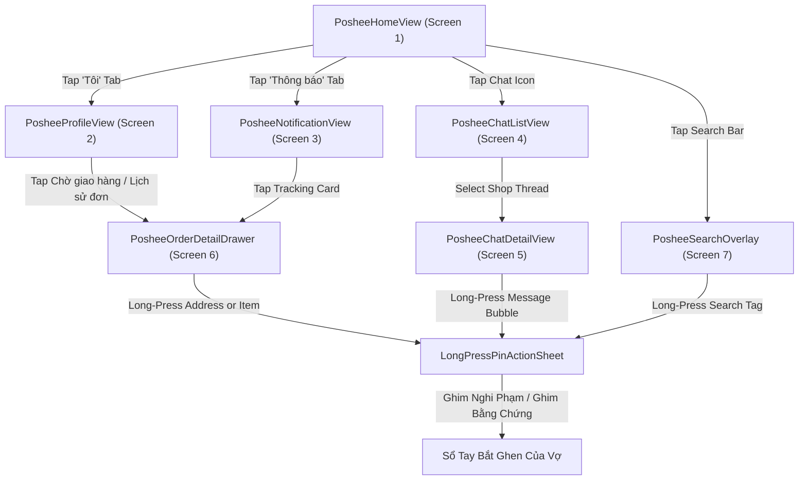

# Shopoo — Canonical ASCII Wireframe Specification

**App ID**: `poshee` (or `ecommerce`)  
**App Name**: Shopoo (Parody of E-Commerce Platforms)
**Parent Specification**: [`app-design.md`](./app-design.md)  
**Functional Features**: [`features.md`](./features.md)  
**Viewport Target**: Mobile Portrait Viewport ($393\text{px} \times 852\text{px}$)  
**Design Standard**: Streamlined E-Commerce Mobile Platform Layout (Parody-tuned, minimal feature bloat)  
**Zero-Emoji Invariant**: Adheres strictly to bracketed semantic tokens (`[Search]`, `[Camera]`, `[Cart: 12]`, `[Chat: 4]`, `[Back]`, `[Store]`, `[Pin]`, `[Badge: 1]`, `[Star: 5.0]`, `[Check: Read]`, etc.)  
**Data Privacy & Anonymization**: All store names, product listings, consumer identities, and addresses are strictly fictionalized, anonymized, and satirized for game narrative lore.

---

## 1. Physical Device Chrome & Status Bar

```
┌────────────────────────────────────────────────────────────────────────┐
│ 12:19 [App: Shopoo]                        [Signal: 5G] [||||] [Batt: 55%] │
└────────────────────────────────────────────────────────────────────────┘
```
- **Clock**: Left-aligned `12:19`, font size $14\text{px}$ Semibold.
- **App Notification Glyph**: Small Shopoo gift box logo `[App: Shopoo]` indicating running application.
- **System Metrics**: Right-aligned cellular protocol `5G`, 4 signal strength bars `[||||]`, and battery capsule `[Batt: 55%]`.
- **Top Bar Surface**: Blends seamlessly into the primary Coral-Orange header (`#EE4D2D`).

---

## 2. Screen 1: Marketplace Home Feed (`PosheeHomeView`)

> **Primary Tab**: `Home` (Active in bottom navigation with orange indicator).  
> **Key Capabilities**: Global search with camera scanner, floating wallet shortcut bar, multi-category icon ribbon, flash sale promo trio banners, 2-column masonry product discovery feed, and streamlined 3-tab bottom navigation (`Home`, `Thông báo`, `Tôi`).

```
┌────────────────────────────────────────────────────────────────────────┐
│ 12:19 [App: Shopoo]                        [Signal: 5G] [||||] [Batt: 55%] │
├────────────────────────────────────────────────────────────────────────┤
│ ┌──────────────────────────────────────────────┐ [Cart: 12]  [Chat: 4] │
│ │ [Search] Mô hình Mecha Lắp ráp...   [Camera] │                       │
│ └──────────────────────────────────────────────┘                       │
├────────────────────────────────────────────────────────────────────────┤
│ ┌────────────────────────────────────────────────────────────────────┐ │
│ │ [-|-] │ [Pay: ShopooPay]        │ [Xu: Điểm danh]  │ [Voucher]     │ │
│ │ QR    │ Gói chào mừng 500k      │ Để nhận Xu!      │ Mã giảm 50%   │ │
│ └────────────────────────────────────────────────────────────────────┘ │
├────────────────────────────────────────────────────────────────────────┤
│ [Thời trang]  [Mỹ phẩm]    [Công nghệ]  [Gia dụng]   [Siêu Rẻ]    [Mã Giảm]│
│ Thời trang    Mỹ phẩm      Công nghệ    Gia dụng     Mua 3 Giảm   Kho Mã   │
│                    ─── [•] ─── (Page Indicator)                        │
├────────────────────────────────────────────────────────────────────────┤
│ ┌──────────────────┐  ┌──────────────────┐  ┌──────────────────┐       │
│ │ FLASH SALE GIỜ   │  │ MỞ DEAL BÍ MẬT   │  │ SIÊU RẺ ĐỒNG GIÁ │       │
│ │ HÀNG NGÀN DEAL   │  │ QUÀ TẶNG BẤT NGỜ │  │ CHỈ TỪ 9.000 Đ   │       │
│ │ [ MUA NGAY > ]   │  │ [ XEM NGAY > ]   │  │ [ MUA NGAY > ]   │       │
│ └──────────────────┘  └──────────────────┘  └──────────────────┘       │
├────────────────────────────────────────────────────────────────────────┤
│ GỢI Ý HÔM NAY (DISCOVERY FEED - 2 COLUMNS)                             │
│ ┌────────────────────────────────────┐ ┌─────────────────────────────┐ │
│ │ [BANNER: NGÀY 15 SALE GIỮA THÁNG]  │ │ [IMG: Chuột Silent Tech]    │ │
│ │ FREESHIP 0Đ • CÒN 1 NGÀY           │ │ [-15%] [VOUCHER XTRA]       │ │
│ │ SALE SỚM TỪ 0H 14.10               │ │ Chuột văn phòng Silent M100 │ │
│ │ SIÊU NHANH SIÊU RẺ                 │ │ [Star: 5.0]       Đã bán 120│ │
│ │ GIẢM ĐẾN 500.000 ĐỒNG              │ │ 85.000 đ    [Freeship Xtra] │ │
│ └────────────────────────────────────┘ └─────────────────────────────┘ │
├────────────────────────────────────────────────────────────────────────┤
│        [Home]                    [Thông báo]               [Tôi]       │
│       (Active)                   [Badge: 5]                            │
│         Home                      Thông báo                 Tôi        │
├────────────────────────────────────────────────────────────────────────┤
│                        ═══════ [ — ] ═══════                           │
└────────────────────────────────────────────────────────────────────────┘
```

### Component Inventory & Layout Tokens (`PosheeHomeView`):
1. **Header Bar ($58\text{px}$)**:
   - Background: Primary Coral-Orange (`#EE4D2D`).
   - Center-Left: Search bar pill (`#FFFFFF`, height $38\text{px}$, border-radius $4\text{px}$) with `[Search]` icon ($18\text{px}$), placeholder text *"Mô hình Mecha Lắp ráp..."* ($13\text{px}$ `#757575`), and right `[Camera]` photo search icon.
   - Right: Shopping cart icon `[Cart: 12]` + Chat bubble icon `[Chat: 4]`.
2. **Floating Quick-Service Strip ($58\text{px}$)**:
   - Floating white card (`#FFFFFF`, corner-radius $8\text{px}$, elevation shadow `0 2px 6px rgba(0,0,0,0.08)`).
   - Column 1: QR scanner shortcut `[-|-]` ($22\text{px}$).
   - Column 2: ShopooPay e-wallet shortcut with subtitle *"Gói chào mừng 500k"*.
   - Column 3: Daily check-in coin *"Điểm danh để nhận Xu!"*.
   - Column 4: Voucher code link *"Mã giảm 50%"*.
3. **Category Icon Ribbon ($76\text{px}$)**:
   - 6 clean categories: Thời trang, Mỹ phẩm, Công nghệ, Gia dụng, Siêu Rẻ, Kho Mã.
4. **Promo Deal Banners ($92\text{px}$)**:
   - 3-card promo row with callouts: *Flash Sale Giờ Vàng*, *Mở Deal Bí Mật*, *Siêu Rẻ Đồng Giá*.
5. **2-Column Masonry Discovery Grid**:
   - Left column campaign promotional tile; right column product cards with image, discount tag (`-15%`), title, rating, price (`85.000 đ`), and sales volume.
6. **Streamlined Bottom Navigation Bar ($54\text{px}$)**:
   - 3 tabs: `Home` (Active `#EE4D2D`), `Thông báo` (with red badge `[5]`), `Tôi`.

---

## 3. Screen 2: User Profile & Order Hub (`PosheeProfileView` / "Tôi" Tab)

> **Primary Tab**: `Tôi` (Active in bottom navigation).  
> **Key Capabilities**: Fictionalized user identity card (`hoang_minh92`), diamond VIP status, lifetime savings tracker, 4-stage order fulfillment pipeline (`Chờ xác nhận`, `Chờ lấy hàng`, `Chờ giao hàng`, `Đánh giá`), campaign shortcuts, utilities strip, and seller center links. (Financial micro-lending / Dịch vụ tài chính completely removed).

```
┌────────────────────────────────────────────────────────────────────────┐
│ 12:19 [App: Shopoo]                        [Signal: 5G] [||||] [Batt: 55%] │
├────────────────────────────────────────────────────────────────────────┤
│ [Avt: hoang_minh] hoang_minh92 [Kim Cương >]  [Settings] [Cart:12] [Chat:4]│
│                   24 Đang theo dõi | 15 Người theo                     │
├────────────────────────────────────────────────────────────────────────┤
│ 👑 [VIP] Với ShopooVIP, bạn đã tiết kiệm: 3.450.000đ                  >│
├────────────────────────────────────────────────────────────────────────┤
│ ĐƠN MUA                                            Xem lịch sử mua hàng >│
│ ┌──────────────┐  ┌──────────────┐  ┌──────────────┐  ┌──────────────┐ │
│ │    [Wallet]  │  │   [Box: 1]   │  │  [Truck: 2]  │  │   [Star: 3]  │ │
│ │ Chờ xác nhận │  │ Chờ lấy hàng │  │ Chờ giao hàng│  │   Đánh giá   │ │
│ └──────────────┘  └──────────────┘  └──────────────┘  └──────────────┘ │
│                                                                        │
│ [Phone] Đơn Nạp điện thoại & Thẻ cào                 Ưu đãi hoàn 10% > │
│ [Box]   Đơn Giao Hỏa Tốc                              Theo dõi lộ trình >│
├────────────────────────────────────────────────────────────────────────┤
│ CHƯƠNG TRÌNH KHUYẾN MÃI                                                │
│ [Trang Chính Sale]       [ShopooVIP]       [Mã Hoàn Xu]      [Kho Voucher]│
├────────────────────────────────────────────────────────────────────────┤
│ TIỆN ÍCH CỦA TÔI                                                       │
│ [Wallet: ShopooPay]        [Coin: Xu •]          [Ticket: Voucher •]   │
│ Ví ShopooPay               Shopoo Xu             Kho Voucher           │
│ Số dư: 450.000đ            Điểm danh nhận xu     12 Mã có sẵn          │
├────────────────────────────────────────────────────────────────────────┤
│ TIỆN ÍCH KHÁC                                              Xem tất cả >│
│ [Shop] Shop của tôi         > │ [Badge] Khách hàng thân thiết         >│
├────────────────────────────────────────────────────────────────────────┤
│        [Home]                    [Thông báo]               [Tôi]       │
│                                  [Badge: 5]               (Active)     │
│         Home                      Thông báo                 Tôi        │
├────────────────────────────────────────────────────────────────────────┤
│                        ═══════ [ — ] ═══════                           │
└────────────────────────────────────────────────────────────────────────┘
```

### Component Inventory & Layout Tokens (`PosheeProfileView`):
1. **User Header Area ($84\text{px}$)**:
   - Gradient background: `#FF5722` to `#EE4D2D`.
   - Circular avatar container ($54\text{px}$), anonymized display name *"hoang_minh92"*, membership badge *"Kim Cương >"* (Dark slate `#455A64` pill, white $11\text{px}$).
   - Top right utility icons: Settings gear, Cart badge `12`, Chat badge `4`.
2. **VIP Savings Banner ($40\text{px}$)**:
   - Light cream-gold background (`#FFF8E1`), border `1px solid #FFE082`, crown glyph, gold savings counter `3.450.000đ`.
3. **Order Lifecycle Pipeline ("Đơn mua") ($110\text{px}$)**:
   - White card container with section title *"Đơn mua"* and right action link *"Xem lịch sử mua hàng >"*.
   - 4 action buttons with icon glyphs and red circular counter pills:
     - `Chờ xác nhận`: Wallet icon.
     - `Chờ lấy hàng`: Box icon with red badge `[Badge: 1]`.
     - `Chờ giao hàng`: Truck icon with red badge `[Badge: 2]` (*Critical clue indicator*).
     - `Đánh giá`: Star icon with red badge `[Badge: 3]`.
4. **My Utilities Strip**:
   - 3 essential utilities: Ví ShopooPay, Shopoo Xu, Kho Voucher.
   - Financial services (*"Dịch vụ tài chính"*) eliminated for parody app conciseness.
5. **Streamlined Bottom Navigation Bar ($54\text{px}$)**:
   - 3 tabs: `Home`, `Thông báo` (badge `5`), `Tôi` (Active).

---

## 4. Screen 3: Notifications Hub (`PosheeNotificationView` / "Thông báo" Tab)

> **Primary Tab**: `Thông báo` (Active in bottom navigation with red badge `[Badge: 5]`).  
> **Key Capabilities**: Pinned logistics order tracking cards with courier tracking IDs, seller notification summaries, promotion announcements, and account security notices (All Live/Video stream tabs and alerts removed).

```
┌────────────────────────────────────────────────────────────────────────┐
│ 12:19 [App: Shopoo]                        [Signal: 5G] [||||] [Batt: 55%] │
├────────────────────────────────────────────────────────────────────────┤
│                              Thông báo          [Cart: 12]   [Chat: 4] │
├────────────────────────────────────────────────────────────────────────┤
│ [Shop] Cập nhật Người bán [Badge: 1]                         Xem thêm >│
├────────────────────────────────────────────────────────────────────────┤
│ [Truck] Cập nhật đơn hàng [Badge: 2]                         Xem thêm >│
│ ┌────────────────────────────────────────────────────────────────────┐ │
│ │ Đang vận chuyển                                                    │ │
│ │ Chi tiết: Đơn hàng #PSH-88120 đang vận chuyển và dự kiến giao đến   │ │
│ │           bạn trong hôm nay.                                       │ │
│ │ 10:38                                                              │ │
│ └────────────────────────────────────────────────────────────────────┘ │
│ ┌────────────────────────────────────────────────────────────────────┐ │
│ │ Giao kiện hàng thành công                                          │ │
│ │ Ghi chú: Kiện hàng SPXVN06801716767A của đơn hàng #PSH-99214 đã     │ │
│ │          giao thành công đến Chung cư mini số 12 ngõ 85... [v]     │ │
│ │ Hôm qua, 18:31                                                     │ │
│ └────────────────────────────────────────────────────────────────────┘ │
├────────────────────────────────────────────────────────────────────────┤
│ Cập nhật mới nhất                                           Đọc Tất Cả │
│  [Nổi bật (3)]       Khuyến mãi [•]       Đơn hàng [•]       Shopoo [•]│
│  ═════════════       ──────────────       ────────────       ──────────│
│                                                                        │
│ [Tag] Mã giảm 50% cho ngành hàng Thời trang nữ đã sẵn sàng!            │
│       HSD: Đến hết ngày 15/10                                    14:00 │
│ ────────────────────────────────────────────────────────────────────── │
│ [Box] Đơn hàng #PSH-88120 đã rời bưu cục phân loại Hà Nội.             │
│       Đơn vị vận chuyển: Shopoo Xử Lý (SPX)                      11:20 │
│ ────────────────────────────────────────────────────────────────────── │
│ [Alert] 🚨 Cảnh báo bảo mật tài khoản                                  │
│         Tuyệt đối KHÔNG chia sẻ mã OTP hoặc mật khẩu Shopoo cho bất kỳ │
│         ai, kể cả nhân viên tự xưng là bưu tá giao hàng.               │
│         18:30 08-10-2026                                               │
├────────────────────────────────────────────────────────────────────────┤
│        [Home]                    [Thông báo]               [Tôi]       │
│                                  (Active: 5)                           │
│         Home                      Thông báo                 Tôi        │
├────────────────────────────────────────────────────────────────────────┤
│                        ═══════ [ — ] ═══════                           │
└────────────────────────────────────────────────────────────────────────┘
```

### Component Inventory & Layout Tokens (`PosheeNotificationView`):
1. **Header Bar ($52\text{px}$)**:
   - Centered title *"Thông báo"* ($17\text{px}$ Semibold `#212121`).
   - Top right utility shortcuts: `[Cart: 12]`, `[Chat: 4]`.
2. **Top Notification Summary Rows ($48\text{px}$ each)**:
   - *"Cập nhật Người bán"* with red badge `[1]`.
   - *"Cập nhật đơn hàng"* with red badge `[2]`.
3. **Pinned Order Logistics Tracking Cards ($74\text{px}$ per card)**:
   - Card 1: *Đang vận chuyển* (Timestamp `10:38`).
   - Card 2: *Giao kiện hàng thành công* (Timestamp `Hôm qua, 18:31`) with courier tracking number `SPXVN06801716767A` and destination snippet.
4. **Latest Updates Stream Tabs ($42\text{px}$)**:
   - Filter sub-tabs: `Thông báo nổi bật (3)` (Active red underline `#EE4D2D`), `Khuyến mãi [•]`, `Đơn hàng [•]`, `Shopoo [•]`. (No video/live stream tab).
5. **Notification Row Feed ($68\text{px}$ per row)**:
   - Voucher drops, shipment departure notifications, and account security advisories.

---

## 5. Screen 4: In-App Chat Inbox (`PosheeChatListView`)

> **Primary Screen**: In-App Seller Chat Directory (Accessed via top right `[Chat]` icon).  
> **Key Capabilities**: Filter pills (`Tất cả`, `Đang hoạt động`), shop verification badges (`[Shop]`, `[Yêu thích]`), unread message counter badges, and automated response previews. (All Live badges removed).

```
┌────────────────────────────────────────────────────────────────────────┐
│ 12:19 [App: Shopoo]                        [Signal: 5G] [||||] [Batt: 55%] │
├────────────────────────────────────────────────────────────────────────┤
│ [<] Chat                                                               │
├────────────────────────────────────────────────────────────────────────┤
│ [ Tất cả • ]       [ Đang hoạt động • ]                                │
├────────────────────────────────────────────────────────────────────────┤
│ [Avt: DudeBasic]       DudeBasic - Official Store                19/09 │
│                        Dạ vâng shop đã gửi hàng rồi ạ      [Badge: 1]  │
├────────────────────────────────────────────────────────────────────────┤
│ [Avt: ToyWorld Fav]    ToyWorld.STORE                            19/09 │
│                        Bạn nhận một liên kết sản phẩm.     [Badge: 2]  │
├────────────────────────────────────────────────────────────────────────┤
│ [Avt: BrickLab]        BrickLab Official                         19/09 │
│                        Dạ tạm thời shop chỉ còn hộp lẻ thôi ạ          │
├────────────────────────────────────────────────────────────────────────┤
│ [Avt: Lingerie]        Lingerie Romance Hanoi                    18/09 │
│                        Dạ em đã che tên sản phẩm trên bao bì rồi [Pin] │
├────────────────────────────────────────────────────────────────────────┤
│                                                                        │
│                                                                        │
│                                                                        │
│                                                                        │
│                                                                        │
├────────────────────────────────────────────────────────────────────────┤
│                        ═══════ [ — ] ═══════                           │
└────────────────────────────────────────────────────────────────────────┘
```

### Component Inventory & Layout Tokens (`PosheeChatListView`):
1. **Header Bar ($52\text{px}$)**:
   - Left: Orange back arrow `[<]` ($22\text{px}$ `#EE4D2D`).
   - Title: *"Chat"* ($18\text{px}$ Bold `#212121`).
2. **Segmented Filter Pills ($40\text{px}$)**:
   - Pill 1: *"Tất cả"* (Light gray background `#EEEEEE`, red dot `[•]`).
   - Pill 2: *"Đang hoạt động"* (Soft peach background `#FFF3E0`, text `#EE4D2D`, red dot `[•]`).
3. **Chat List Rows ($72\text{px}$ height per row)**:
   - **Avatar Container ($48\text{px}$)**: Circular store logo with optional red tag `[Yêu thích]`.
   - **Store Name**: Semibold $15\text{px}$ `#212121` (anonymized parody shops).
   - **Message Preview**: Regular $13\text{px}$ `#757575`.
   - **Timestamp**: Regular $11\text{px}$ `#9E9E9E` (e.g. `19/09`).
   - **Unread Badge**: Circular red pill (`#EE4D2D`, white bold $11\text{px}$) e.g. `[Badge: 1]`, `[Badge: 2]`.

---

## 6. Screen 5: In-App Chat Conversation Detail (`PosheeChatDetailView`)

> **Primary Screen**: Seller Conversation Thread with Embedded Pinned Product Card.  
> **Key Capabilities**: Seller online status, anti-fraud compliance warning banner, interactive pinned product enquiry card with SKU variant selector and instant voucher CTA, automated response bubbles, customer inquiries, and non-video prompt chips.

```
┌────────────────────────────────────────────────────────────────────────┐
│ 12:19 [App: Shopoo]                        [Signal: 5G] [||||] [Batt: 55%] │
├────────────────────────────────────────────────────────────────────────┤
│ [<] [Avt: DudeBasic] DudeBasic - Official Store          [Store] [•••] │
│                      • Trực tuyến                                      │
├────────────────────────────────────────────────────────────────────────┤
│ ┌────────────────────────────────────────────────────────────────────┐ │
│ │ ⚠️ LƯU Ý: Shopoo KHÔNG cho phép hành vi: Đặt cọc/Chuyển khoản      │ │
│ │ riêng/Giao dịch ngoài nền tảng/Tuyển CTV/Hủy đơn theo yêu cầu...   │ │
│ │ Vui lòng chỉ Mua-Bán trực tiếp trên Shopoo để bảo vệ quyền lợi.    │ │
│ │                Tìm hiểu thêm | Tố cáo người dùng này!              │ │
│ └────────────────────────────────────────────────────────────────────┘ │
├────────────────────────────────────────────────────────────────────────┤
│ ┌────────────────────────────────────────────────────────────────────┐ │
│ │ Bạn đang hỏi về quy cách sản phẩm                                  │ │
│ │ ┌──────────┐  Áo thun nam polo basic thoáng khí...                 │ │
│ │ │ [Img]    │  TRẮNG, 3XL >                                         │ │
│ │ │          │  [Rẻ Vô Địch]  [COD]                                  │ │
│ │ │Đã bán 36k│  245.000 đ  [-30%]  [Freeship]                        │ │
│ │ └──────────┘  ┌──────┐ ┌─────────────────────────────────────────┐ │ │
│ │               │[Cart]│ │          Mua với voucher                │ │ │
│ │               └──────┘ └─────────────────────────────────────────┘ │ │
│ └────────────────────────────────────────────────────────────────────┘ │
├────────────────────────────────────────────────────────────────────────┤
│                               [ 19 thg 9 ]                             │
│                                                                        │
│ ┌───────────────────────────────────────────────┐                      │
│ │ Cảm ơn Anh/Chị đã quan tâm đến cửa hàng.      │                      │
│ │ Mình cần em hỗ trợ gì ạ?                      │                      │
│ │                                               │                      │
│ │ Tin nhắn tự động                        20:18 │                      │
│ └───────────────────────────────────────────────┘                      │
│                                                                        │
│                      ┌───────────────────────────────────────────────┐ │
│                      │ Bao h thì về thêm áo này sz 3xl hả shop       │ │
│                      │                                     20:18 [✓✓]│ │
│                      └───────────────────────────────────────────────┘ │
│                                                                        │
│ ─────────────────────── Tin nhắn chưa đọc ──────────────────────────── │
│                                                                        │
│ ┌───────────────────────────────────────────────┐                      │
│ │ Dạ mẫu này bên em vẫn chưa có kế hoạch cụ thể │                      │
│ │ ngày về thêm ạ                                │                      │
│ │                                         20:44 │                      │
│ └───────────────────────────────────────────────┘                      │
│                                                                        │
│                    [ Hộp thư tự động sẽ phản hồi thêm ]                │
├────────────────────────────────────────────────────────────────────────┤
│ [ Hỏi tình trạng còn hàng ]             [ Tư vấn chọn size ]           │
├────────────────────────────────────────────────────────────────────────┤
│ [+]  [Bag]  ┌─────────────────────────────────────────────┐   [Smile]  │
│             │ Soạn tin...                                 │            │
│             └─────────────────────────────────────────────┘            │
├────────────────────────────────────────────────────────────────────────┤
│                        ═══════ [ — ] ═══════                           │
└────────────────────────────────────────────────────────────────────────┘
```

### Component Inventory & Layout Tokens (`PosheeChatDetailView`):
1. **Header Bar ($56\text{px}$)**:
   - Orange back arrow `[<]`, circular shop avatar.
   - Title: *"DudeBasic - Official Store"* ($15\text{px}$ Bold `#212121`).
   - Subtitle: *"• Trực tuyến"* ($11\text{px}$ `#757575`).
   - Right shortcuts: Storefront icon `[Store]`, overflow menu `[•••]`.
2. **Anti-Fraud Safety Notice ($68\text{px}$)**:
   - Background: Pale Gold Cream (`#FFF8E1`), border `1px solid #FFE082`, padding $8\text{px} \times 12\text{px}$.
   - Warning text advising players against out-of-platform transactions.
3. **Pinned Product Enquiry Card ($118\text{px}$)**:
   - Pure white card displaying thumbnail, product title (*"Áo thun nam polo basic thoáng khí"*), SKU variant (*"TRẮNG, 3XL >"*), price (`245.000 đ`), discount tag `-30%`, and action button *"Mua với voucher"*.
4. **Message Bubbles**:
   - Outgoing bubble: Mint Turquoise (`#E0F7FA`), double checkmarks `[✓✓]`.
   - Incoming bubble: Pure White (`#FFFFFF`), border `1px solid #E0E0E0`.
5. **Quick Prompt Action Chips ($36\text{px}$)**:
   - Non-video shopping prompts: `[Hỏi tình trạng còn hàng]`, `[Tư vấn chọn size]`. (Livestream action removed).
6. **Chat Input Bar ($52\text{px}$)**:
   - Attachment `[+]`, Product bag selector `[Bag]`, input text placeholder *"Soạn tin..."*, smiley emoji selector `[Smile]`.

---

## 7. Screen 6: Order Detail & Shipping Address Inspector Drawer (`PosheeOrderDetailDrawer`)

> **Primary Screen**: Forensic Evidence Inspector Modal Drawer.  
> **Key Capabilities**: Full invoice breakdown, courier tracking ID (SPX), recipient address inspector (`CLUE-POSH-01`), SKU size mismatch inspector (`CLUE-POSH-02`), and universal long-press pinning into **Sổ Tay Bắt Ghen Của Vợ**.

```
┌────────────────────────────────────────────────────────────────────────┐
│ 12:19 [App: Shopoo]                        [Signal: 5G] [||||] [Batt: 55%] │
├────────────────────────────────────────────────────────────────────────┤
│ [ Đóng ✕ ]               CHI TIẾT ĐƠN HÀNG                             │
├────────────────────────────────────────────────────────────────────────┤
│ 📦 TRẠNG THÁI: GIAO HÀNG THÀNH CÔNG                                    │
│    Mã đơn hàng: #PSH-99214       Mã vận đơn: SPXVN06801716767A         │
│    Đơn vị vận chuyển: Shopoo Xử Lý (SPX Express)                       │
│    Thời gian đặt hàng: 10/10/2026 14:15                                │
├────────────────────────────────────────────────────────────────────────┤
│ 📍 ĐỊA CHỈ NHẬN HÀNG (THÔNG TIN NGƯỜI NHẬN):                           │
│    Thu Trang | (+84) 912 *** 688                                       │
│    Chung cư mini số 12 ngõ 85 Chùa Láng, P. Láng Thượng, Đống Đa, HN   │
├────────────────────────────────────────────────────────────────────────┤
│ SẢN PHẨM:                                                              │
│ ┌──────────┐  Váy ngủ lụa satin phối ren 2 dây cao cấp quyến rũ        │
│ │ [Img]    │  Phân loại: [Màu Đỏ Rượu] - [Size S]                      │
│ │          │  Số lượng: 1 x 680.000 đ                                  │
│ └──────────┘                                                           │
│                                                                        │
│ • Tổng tiền hàng:                                            680.000 đ │
│ • Phí vận chuyển:                                             25.000 đ │
│ • Voucher giảm giá Shopoo:                                   -25.000 đ │
│ • TỔNG THANH TOÁN (Đã trả qua ShopooPay):                    680.000 đ │
├────────────────────────────────────────────────────────────────────────┤
│                        ═══════ [ — ] ═══════                           │
└────────────────────────────────────────────────────────────────────────┘
```

---

## 8. Screen 7: Search Keyword Tag Cloud Overlay (`PosheeSearchOverlay`)

> **Primary Screen**: Search Bar Focus Overlay.  
> **Key Capabilities**: Historical search tags (`CLUE-POSH-04`), clear history shortcut, and trending parody marketplace queries. Zero spoiler cues on tags.

```
┌────────────────────────────────────────────────────────────────────────┐
│ 12:19 [App: Shopoo]                        [Signal: 5G] [||||] [Batt: 55%] │
├────────────────────────────────────────────────────────────────────────┤
│ [<]  ┌──────────────────────────────────────────────┐  [Tìm kiếm]      │
│      │ [Search] Váy ngủ lụa quyến rũ...     [Clear] │                  │
│      └──────────────────────────────────────────────┘                  │
├────────────────────────────────────────────────────────────────────────┤
│ LỊCH SỬ TÌM KIẾM GẦN ĐÂY                                [ Xoá lịch sử ]│
│                                                                        │
│  [ nội y quyến rũ ]                [ váy body tôn dáng ]               │
│                                                                        │
│  [ quà sinh nhật bạn gái mới quen ]   [ son môi Lior Matte 999 ]       │
│                                                                        │
│  [ dây rút nhựa 20cm ]             [ củ sạc nhanh 65w GaN ]            │
├────────────────────────────────────────────────────────────────────────┤
│ TÌM KIẾM PHỔ BIẾN TRÊN SHOPOO                                          │
│                                                                        │
│  1. Tai nghe không dây chống ồn                                        │
│  2. Áo polo nam thoáng khí basic                                       │
│  3. Giá đỡ điện thoại ô tô                                             │
│  4. Cà phê rang mộc nguyên chất 500g                                   │
├────────────────────────────────────────────────────────────────────────┤
│                        ═══════ [ — ] ═══════                           │
└────────────────────────────────────────────────────────────────────────┘
```

---

## 9. Screen Flows & State Transitions



---

## 10. Interactive Clue Hotspots & Forensic Trigger Matrix

| Clue ID | Component / Hotspot | Trigger Action | Forensic Disclosure | Suspect Linkage |
|---|---|---|---|---|
| `CLUE-POSH-01` | `PosheeOrderDetailDrawer` • Shipping Address | Long-press recipient info row ($\ge 450\text{ms}$) | Reveals delivery to *"Chung cư mini số 12 ngõ 85 Chùa Láng"*, recipient *"Thu Trang ((+84) 912 *** 688)"*. | `suspect_trang` (Sugar Baby) |
| `CLUE-POSH-02` | `PosheeOrderDetailDrawer` • Sizing Variant | Long-press product variant row inside invoice ($\ge 450\text{ms}$) | Item ordered is *"Size S / Đỏ Rượu"*; wife profile explicitly records wife wears **Size L**. | Contradiction proof of infidelity |
| `CLUE-POSH-03` | `PosheeOrderDetailDrawer` • Red Herring Gift | Long-press delivery address of robot vacuum ($\ge 450\text{ms}$) | Shipped to *"Người nhận: Chị Mai - Chị ruột"* at family hometown address. | `suspect_mai` (Innocent Red Herring) |
| `CLUE-POSH-04` | `PosheeSearchOverlay` • Tag Cloud | Long-press search keyword chip ($\ge 450\text{ms}$) | Displays recent search tags: *"nội y quyến rũ"*, *"váy body tôn dáng"*, *"quà sinh nhật bạn gái mới quen"*. | Intent evidence |
| `CLUE-POSH-05` | `PosheeChatDetailView` • Seller Inquiry | Long-press customer message bubble ($\ge 450\text{ms}$) | Husband asks seller: *"Shop che tên sản phẩm trên bao bì giúp mình nhé, giao kín đáo"* or asks about 1m58/46kg sizing fit. | Concealment proof |
| `CLUE-POSH-06` | `PosheeNotificationView` • Logistics Stream | Long-press tracking status item ($\ge 450\text{ms}$) | SPX courier delivered parcel to office lobby at 22:30 or alternate delivery hub. | Schedule contradiction |
