---
type: Deployment Architecture
status: approved
description: "Deployment and hosting specification for zero-backend static web hosting on GitHub Pages (*.github.io) via automated GitHub Actions CI/CD."
tags: [architecture, deployment, hosting, github-pages, ci-cd]
timestamp: "2026-10-13T14:05:00+07:00"
---

# Hosting & Deployment Architecture — GitHub Pages (`github.io`)

> **Architectural Purpose**: Establishes the canonical deployment and hosting architecture for the *Jealous Wife Detective Game*, defining the static distribution model, GitHub Actions automation, bundler configuration rules, and platform constraints for publishing to GitHub Pages (`*.github.io`).

---

## 1. Hosting Platform & Architectural Fit

The application is architected as a **100% client-side static web application** executing entirely in modern mobile evergreen browsers. Deploying to GitHub Pages (`https://<username>.github.io/<repo-name>/`) is an exact architectural match:

| Vision & Scope Constraint | GitHub Pages Capability | Architectural Evaluation |
|---|---|---|
| **Zero Backend & Server Database** | Free static file distribution serving pre-compiled HTML, CSS, JavaScript, and static media | Exact match; zero infrastructure management |
| **Zero Operational Cost ($0 OpEx)** | Native GitHub Pages hosting included with repository | 100% compliant with free-to-play B2C budget |
| **Client-Side State Persistence** | Browser `localStorage` retains level unlocks, star ratings, and earned wife titles | Runs entirely on user device with zero server sync |
| **Performance SLA (< 100ms switching)** | Distributed Fastly CDN edge caching delivers ultra-low latency for static bundles | Satisfies performance SLA |
| **Privacy Compliance (13+ Minors)** | Zero server logs, zero telemetry, zero cookie banners required | Compliant with COPPA / minor privacy best practices |
| **Default HTTPS Enforcement** | Automated SSL/TLS certificates provided by GitHub | Ensures secure clipboard, audio, and canvas APIs |

---

## 2. Automated CI/CD Pipeline (`.github/workflows/deploy.yml`)

Deployment is fully automated using GitHub Actions. Any push to the canonical repository branch (`main`) automatically builds the static web bundle and deploys it to the GitHub Pages environment.

```mermaid
flowchart LR
    Push["git push origin main"] --> Checkout["actions/checkout@v4"]
    Checkout --> Setup["actions/setup-node@v4<br/>(Node 20+)"]
    Setup --> Install["npm ci / pnpm install"]
    Install --> Build["npm run build<br/>(Vite compile to /dist)"]
    Build --> Upload["actions/upload-pages-artifact@v3"]
    Upload --> Deploy["actions/deploy-pages@v4"]
    Deploy --> Live["Live on GitHub Pages<br/>(https://username.github.io/repo)"]
```



### Reference Workflow Definition (`.github/workflows/deploy.yml`)
```yaml
name: Deploy Static Game to GitHub Pages

on:
  push:
    branches:
      - main
  workflow_dispatch:

permissions:
  contents: read
  pages: write
  id-token: write

concurrency:
  group: pages
  cancel-in-progress: false

jobs:
  build:
    runs-on: ubuntu-latest
    steps:
      - name: Checkout Repository
        uses: actions/checkout@v4

      - name: Setup Node.js Runtime
        uses: actions/setup-node@v4
        with:
          node-version: 20
          cache: npm

      - name: Install Dependencies
        run: npm ci

      - name: Build Production Bundle
        run: npm run build

      - name: Upload GitHub Pages Artifact
        uses: actions/upload-pages-artifact@v3
        with:
          path: ./dist

  deploy:
    environment:
      name: github-pages
      url: ${{ steps.deployment.outputs.page_url }}
    runs-on: ubuntu-latest
    needs: build
    steps:
      - name: Deploy to GitHub Pages
        id: deployment
        uses: actions/deploy-pages@v4
```

---

## 3. Bundler & Frontend Configuration Rules

To prevent common static hosting issues on GitHub Pages, frontend project scaffolding must enforce the following rules:

### 3.1. Subpath Base URL Resolution
* **Context**: Project sites on GitHub Pages are served from a subpath (`https://<username>.github.io/<repository-name>/`), not from domain root (`/`). Hardcoded root paths (`/assets/icon.png`) result in HTTP 404 errors.
* **Rule**: In `vite.config.ts`, declare relative or environment-driven base resolution:
  ```typescript
  import { defineConfig } from 'vite';
  import react from '@vitejs/plugin-react';

  export default defineConfig({
    plugins: [react()],
    base: './', // Or process.env.GITHUB_PAGES ? '/Detective/' : '/'
  });
  ```

### 3.2. Virtual Navigation & SPA Routing
* **Context**: GitHub Pages lacks native URL rewriting for HTML5 History API (`pushState`). Direct browser navigation or reloads on paths like `/loza` yield a 404 error from the GitHub web server.
* **Rule**: The game uses **virtual in-shell navigation** where the smartphone shell switches active views via internal component state (`activeApp: 'home' | 'loza' | 'bank' | ...`). If URL synchronization is desired for deep-linking, the project must utilize hash routing (`createHashRouter` / `HashRouter`) to preserve complete static hosting compatibility.

### 3.3. Asset Packaging & Performance Budget
* **Context**: Non-functional requirements mandate initial asset bundle $< 5\text{ MB}$ to guarantee instant mobile load on cellular data.
* **Rule**: Evidence images and icons must be authored in modern WebP or optimized SVG formats. Voice note audio snippets (`CLUE-LOZA-05`) must be encoded in compressed MP3/AAC ($< 64\text{ kbps}$ mono voice profile).

---

## 4. Security, Privacy & Custom Domains

1. **Zero Data Retention**: The GitHub Pages web server serves static files only. No runtime application state, user inputs, or detective verdicts ever leave the client's device.
2. **Custom Domain Support (Optional)**: If the project transitions from `*.github.io` to a custom domain *(e.g. `votucgian.vn` or `detective-wife.com`)*, a `CNAME` record can be committed to the root directory with zero code refactoring.

---

## 5. Commercial Boundary & CR Evaluation

* **Commercial Baseline Status**: `NO CHANGE REQUEST (CR) TRIGGERED`.
* **Rationale**: Static deployment to GitHub Pages strictly fulfills the contracted MVP boundaries in `vision-scope.md` (no backend APIs, no server databases, no hosting expenditures, and client-side static delivery).

