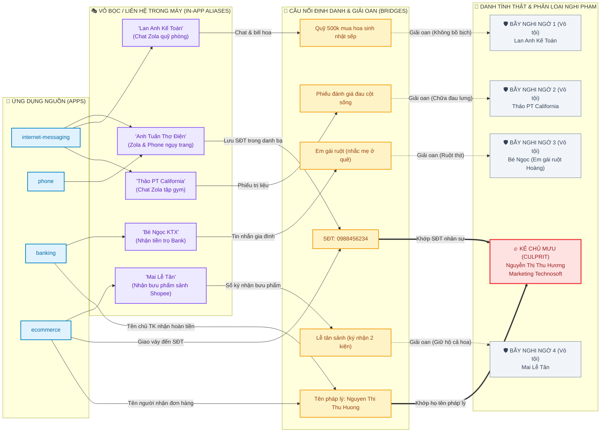
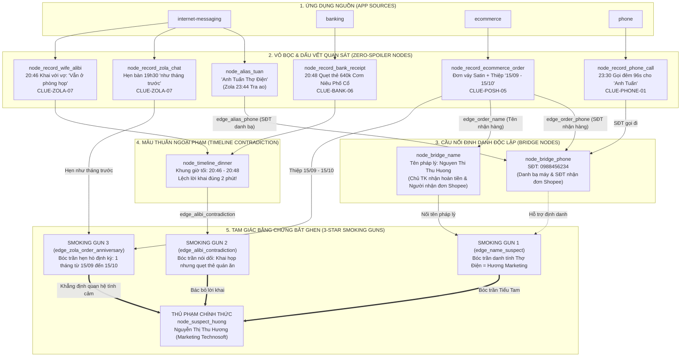

# Hồ sơ Đặc tả Cốt truyện — Màn 1: Cơn ghen lúc nửa đêm

> **Thẩm quyền Tác giả**: Được thiết kế bởi `level-designer`. Là căn cứ cốt truyện pháp y duy nhất (SSOT) tuân thủ nghiêm ngặt **Nguyên tắc Bằng chứng Gián tiếp (Subtle Clues Invariant - Zero Obvious Spoilers)** và **Danh mục Tên Ứng dụng Chuẩn (Generic App Names)**. Bàn giao cho `@frontend-game-developer` để hiện thực hóa file cấu hình `src/data/cases/hoang/level_01.json`.

---

## 1. Bối cảnh Vụ án & Chân dung Người Chồng

### 1.1. Chân dung Người Chồng
- **Họ và Tên / Biệt danh**: Hoàng (Chồng IT / Tech Lead tại Technosoft).
- **Tuổi & Nghề nghiệp**: 29 tuổi, Senior Full-stack Developer.
- **Nhóm tuổi & Thế hệ (generationTag)**: Millennial (29 tuổi, dân kỹ thuật IT / Tech Lead).
- **Phong cách Ngôn ngữ & Khẩu khí Chat (chatTone)**: Nửa đùa nửa thật, luôn miệng nịnh vợ để che giấu bí mật, dùng tiếng lóng công sở IT (*"sprint"*, *"OT"*, *"fix bug"*, *"deploy"*, *"chốt task"*, *"feedback"*). Nhắn tin có dấu chỉnh tề nhưng khéo léo lồng ghép thuật ngữ công việc khi viện cớ bận họp đột xuất.
- **Thói quen Ứng dụng & Lối sống (lifestyleHabits)**: Banking Techcombank kiểm tra lương thưởng và quỹ đen, Shopee áp mã Freeship Extra giao giờ hành chính, GrapCar đi làm, NetSurf đọc tin công nghệ/thể thao, ghi chú bảo dưỡng xe máy. Vỏ bọc ngụy trang bồ nhí là danh bạ kỹ thuật "Anh Tuấn Thợ Điện".
- **Tính cách Đặc trưng**: Vẻ ngoài hiền lành, mẫu mực, luôn miệng khen cơm vợ nấu ngon nhất trần đời, tự nhận là người "sợ vợ số một thiên hạ", lương tháng nộp đủ 90%. Tuy nhiên, gần đây có thói quen cực kỳ đáng ngờ: luôn úp màn hình điện thoại xuống mặt bàn mỗi khi ngồi cạnh vợ, hay mang máy vào phòng tắm "ngâm" hàng tiếng đồng hồ, và thường xuyên viện cớ "thức đêm ôm laptop fix bug giỏ hàng gấp cho kịp sprint".
- **Hành vi Khả nghi Kích hoạt Cơn Ghen**: Đúng 23:45 đêm, khi Hoàng vờ ngáy ngủ say sưa trên giường, màn hình điện thoại chợt sáng đèn với một thông báo tin nhắn từ danh bạ "Anh Tuấn Thợ Điện" nhắn “Áo anh em treo lên rồi, mai mang trả nhé.”. Chi tiết bất thường này giục giã người vợ phải lén mở khóa máy kiểm tra.

### 1.2. Chất liệu Trào phúng & Drama Gia đình Việt
- **Giữ nền truyện**: Hoàng, 29 tuổi, lập trình viên Technosoft; người tình Hương được lưu thành “Anh Tuấn Thợ Điện”. Giữ năm nghi phạm và kết luận `cheating`.
- **Sự thật dành cho tác giả**: Hoàng gặp riêng Hương vào tối 15/10 để đánh dấu một tháng từ 15/09, mua váy kèm thiệp, đồng thời nói với vợ đang họp cùng nhóm ở công ty. Sinh hoạt gia đình và công việc vẫn diễn ra bình thường; chiếc điện thoại không phải danh sách tang chứng được xếp sẵn.
- **Nguyên tắc lần sửa này**: Không dùng ngoại lệ manh mối trực diện của Màn 1. Một giao dịch chia tiền ăn, một đơn váy hoặc một cuộc gọi đêm đều có lý do vô hại nếu đứng riêng. Chuỗi đối chiếu gồm lời khai với vợ, giờ hẹn ăn, thanh toán nhà hàng, mốc trên thiệp và danh tính giao nhận.
- **Dữ liệu chi tiết**: [level-01-phone-data.md](level-01-phone-data.md) là phần nội dung bắt buộc của hồ sơ này, gồm lời thoại và bản ghi sinh hoạt cho từng ứng dụng. Đây là thiết kế mới được đề xuất trong lần sửa, chưa phải mô tả dữ liệu đã chạy trong ứng dụng.

---

## 2. Danh sách Nghi phạm & Vỏ bọc Ngụy trang

| Suspect ID | Tên Hiển thị | Thân phận Thật / Nghề nghiệp | App Phát hiện Đầu tiên | Vỏ bọc Danh bạ / Biệt danh | Vai trò Cốt truyện |
|---|---|---|---|---|---|
| `suspect_huong` | Hương Marketing | Nguyễn Thị Thu Hương — Chuyên viên Marketing cùng công ty Technosoft | `internet-messaging` | "Anh Tuấn Thợ Điện" | **Kẻ chủ mưu thực sự (Culprit)** |
| `suspect_lan_anh` | Lan Anh Kế Toán | Thủ quỹ công đoàn kiêm Kế toán nội bộ Technosoft | `internet-messaging` | "Lan Anh Kế Toán" | **Bẫy nghi ngờ có Twist (Red Herring 1)** |
| `suspect_thao` | Thảo PT Gym | Nữ huấn luyện viên thể hình California Fitness | `internet-messaging` | "Thảo PT California" | **Bẫy nghi ngờ thể hình (Red Herring 2)** |
| `suspect_ngoc` | Bé Ngọc Sinh Viên | Em gái ruột của Hoàng ở quê lên trọ học đại học | `banking` | "Bé Ngọc KTX" | **Bẫy nghi ngờ chu cấp (Red Herring 3)** |
| `suspect_mai` | Mai Lễ Tân | Nhân viên lễ tân sảnh tòa nhà Technosoft | `ecommerce` | "Mai Lễ Tân" | Bẫy nhận hộ bưu phẩm (Red Herring 4) |

### 2.1. Sơ Đồ Bóc Trần Vỏ Bọc & Cầu Nối Danh Tính (Identity & Alias Decoupling Map)

---

## 3. Sự thật, Lời Roasting & Thang Ngụy biện

### 3.1. Phân loại Kết luận Sự thật (Ground Truth)
- **Kết luận (`verdict`)**: `cheating`
- **Mã Tiểu tam (`culpritSuspectId`)**: `suspect_huong`

### 3.2. Lời Roasting Kết thúc Vụ án
- **Chiến thắng (`narrativeRoast`)**:
  > “Thợ điện gì mà hẹn lại đúng ngày, nhận váy kèm thiệp riêng, còn khiến anh họp ở công ty mà quẹt thẻ tận quán cơm! Anh sửa điện hay sửa luôn lời khai?”
- **Ghen nhầm Lan Anh (`overJealousRoast`)**:
  > “Năm người góp mỗi người một trăm mua quà cho sếp. Em đọc đến dòng thứ ba là giải được, sao lại đối chất từ dòng thứ nhất?”
- **Ghen nhầm Thảo**:
  > “Người ta nhắc anh mang phiếu đánh giá cột sống. Em bắt được lưng đau, chưa bắt được người tình.”
- **Ghen nhầm Ngọc**:
  > “Em gái nhắn cảm ơn anh trai còn chưa đủ rõ à? Chủ nhật về quê chắc phải giới thiệu lại gia phả.”
- **Ghen nhầm Mai**:
  > “Mai giữ cả hoa sinh nhật lẫn gói đồ, còn nhắc anh ký sổ. Sảnh lễ tân đâu phải danh sách người tình.”
- **Hết 5 lượt nghi ngờ**:
  > “Hoàng giật lại máy: ‘Em kiểm tra điện thoại hay kiểm kê cả khu phố đấy? Mai anh còn đi làm!’”

### 3.3. Thang Ngụy biện Khi Đối chất Sớm ("Chối bay chối biến")
| Số lượng Thẻ Bằng chứng hợp lệ, không trùng Clue ID | Thái độ Người Chồng | Lời Thoại Ngụy biện Điển hình | Kết quả |
|---|---|---|---|
| **0 Thẻ (Cáo buộc non)** | Hùng hổ, gạt phăng | *"Em lại lướt TikTok xem mấy cái clip drama bắt ghen xàm xí rồi đa nghi đúng không? Đưa máy đây anh đi ngủ mai còn đi làm!"* | Thất bại (0 Sao) |
| **1 Thẻ (Một chi tiết nghi vấn)** | Hơi giật mình, phân bua | *"Ơ kìa em, số thợ điện đấy thật mà, hôm trước anh gọi nhờ sửa cái đường dây mạng ở văn phòng thôi chứ có gì đâu!"* | Chiến thắng 1 Sao (Thắng non) |
| **2 Thẻ (Đã đối chiếu hai nguồn)** | Toát mồ hôi, bao biện | *"À... cái đơn hàng đó là con bé phòng Marketing nó nhờ anh đặt hộ qua tài khoản mua sắm để áp mã Freeship Extra thôi mà, anh biết gì đâu!"* | Chiến thắng 2 Sao (Khá thuyết phục) |
| **3+ Thẻ (Đủ chuỗi đối chiếu)** | Cúi đầu nhận tội | *"Anh xin lỗi vợ... Bọn anh có hẹn riêng tối nay. Anh không nên nói dối em là còn họp, em cho anh giải thích..."* | Chiến thắng Tuyệt đối 3 Sao |

---

## 4. Cấu hình Ứng dụng & Mồi nhử Thông báo

### 4.1. Phân cấp Độ khó
- **Màn chơi**: Màn 1, khởi động. `allowedStrikes`: **5 strikes**. `lockChallenges`: **0 locks**.
- **Bốn app có manh mối**: `internet-messaging`, `banking`, `ecommerce`, `phone`.
- **Đồng hồ**: D = 15/10, lúc 23:45; pin 42%, mạng 5G, màu PWA `#0f172a`. Ngày thuộc truyện, không lấy ngày hệ thống.
- Giữ cách tính sao hiện hành tại mục 3.3. Một thẻ vẫn chỉ là thắng non theo cơ chế hướng dẫn, không viết lời thừa nhận toàn bộ quan hệ khi chỉ có một chi tiết. Lời thú nhận và roast hoàn chỉnh dành cho kết quả đủ chuỗi.

### 4.2. Bảng Phân bổ Trạng thái Ứng dụng

| App ID | Vai trò | Dữ liệu yêu cầu |
|---|---|---|
| `internet-messaging` | Manh mối + sinh hoạt | 10 luồng, chỉ 2 luồng mang cùng manh mối lịch hẹn/lời khai; 8 luồng gia đình, bạn bè, công việc và giải oan |
| `banking` | Manh mối + sinh hoạt | 60 giao dịch; 2 bản ghi liên quan Hương/bữa tối, còn lại lương, sinh hoạt, hóa đơn, mua sắm, chia tiền |
| `ecommerce` | Manh mối + sinh hoạt | 22 đơn, chỉ 1 đơn liên quan vụ án; 8 luồng chat người bán, từ khóa và thông báo bình thường |
| `phone` | Manh mối bổ trợ + sinh hoạt | 46 cuộc gọi, chỉ 1 cuộc mang clue; 16 liên hệ, không bổ sung nhãn tình nhân |
| `messages` | Sinh hoạt | 16 luồng SMS nạp tiền, giao hàng, bảo trì, quảng cáo, hoàn tiền, mẹ gọi lại |
| `ride-hailing` | Sinh hoạt | 20 hoạt động đi làm, về nhà, siêu thị, đồ ăn, hủy chuyến |
| `web-browser` | Sinh hoạt | 25 lịch sử đọc và 2 tab mở về nghề nghiệp, bóng đá, việc nhà |
| `photos` | Sinh hoạt | 16 ảnh gia đình, đồ ăn, công việc và đồ dùng; không ảnh phản chiếu hoặc album khóa |
| `personal-notes` | Sinh hoạt | 14 ghi chú việc nhà, về quê, sức khỏe, bảo dưỡng xe, việc ngày mai |
| `email` | Sinh hoạt | 25 thư có thân thư, gồm lương, internet, bản tin, tập trị liệu, hoàn tiền |
| `professional-network` | Sinh hoạt | 12 bài/cập nhật nghề nghiệp và trao đổi công khai |
| `team-collaboration` | Sinh hoạt | 12 mục trao đổi dự án, hành chính và hỗ trợ |

Các số trên là hợp đồng nội dung thiết kế; không khẳng định runtime đã hiển thị đủ ứng dụng. Không thêm app vào launcher hoặc mở rộng tính năng để đạt số lượng. `phone` và `messages` là hai app riêng; nếu cấu hình cũ còn `comms`, triển khai phải chuẩn hóa theo hợp đồng hiện hành, không tạo hai bản sao dữ liệu.

Tổng lịch sử mở rộng và nội dung bổ sung: [level-01-history.md](level-01-history.md) (Tài liệu lưu trữ lịch sử nền của riêng Màn 1 đã compile vào `level_01.json`; từ Màn 2 trở đi tuân thủ Chuẩn gói 2 file, không tạo thêm file history). Zola có 265 tin trong 10 luồng chính; SMS có 104 tin. Các bản ghi không liên quan vụ án vẫn giữ vai trò sinh hoạt.

### 4.3. Thông báo Mồi nhử
- `toast_01`, nguồn `internet-messaging`, sau 4 giây.
- Tiêu đề: “Tin nhắn • Vừa xong”.
- Nội dung: `Anh Tuấn Thợ Điện: Áo anh em treo lên rồi, mai mang trả nhé.`
- Tin gốc trong luồng có giờ D 23:44. Điểm lạ là giờ nhắn và người gửi; thông báo không nêu tên Hương, loại quà, ngày kỷ niệm hoặc kết luận.

---

## 5. Đồ Thị Bằng Chứng & Ma Trận Dữ Liệu Pháp Y

### 5.1. Sơ Đồ Đồ Thị Bằng Chứng & Mâu Thuẫn Ngoại Phạm (Mermaid Diagram)

### 5.2. Bảng Dữ Liệu Nodes & Edges (Compiler & Tooling SSOT)

#### Danh sách Nodes
| Node ID | Loại (`type`) | Tên hiển thị (`label`) | App nguồn / Record ID | Clue ID | Vỏ bọc ban đầu (`isInitialDisguise`) |
|---|---|---|---|---|---|
| `node_suspect_huong` | `suspect` | Nguyễn Thị Thu Hương · Marketing | - | - | `false` |
| `node_suspect_lan_anh` | `suspect` | Lan Anh Kế Toán | - | - | `false` |
| `node_alias_tuan` | `alias` | "Anh Tuấn Thợ Điện" | `internet-messaging` / `thread_tuan` | `CLUE-ZOLA-07` | `true` |
| `node_bridge_phone` | `bridge_id` | SĐT: `0988456234` | `phone` & `ecommerce` / `order_01` | `CLUE-PHONE-01` | `false` |
| `node_bridge_name` | `bridge_id` | Tên pháp lý: `Nguyen Thi Thu Huong` | `ecommerce` / `order_01` & `banking` / `tx_02` | `CLUE-BANK-06` | `false` |
| `node_record_zola_chat` | `record_clue` | Tin nhắn: Bàn 19h30 "như tháng trước" | `internet-messaging` / `thread_tuan` | `CLUE-ZOLA-07` | `false` |
| `node_record_wife_alibi` | `record_clue` | Tin nhắn báo vợ: "Vẫn ở phòng họp" (20:46) | `internet-messaging` / `thread_wife` | `CLUE-ZOLA-07` | `false` |
| `node_record_bank_receipt`| `record_clue` | Quẹt thẻ: Cơm Niêu Phố Cổ 640k (20:48) | `banking` / `tx_01` | `CLUE-BANK-06` | `false` |
| `node_record_ecommerce_order`| `record_clue`| Đơn váy Satin + thiệp "15/09 - 15/10" | `ecommerce` / `order_01` | `CLUE-POSH-05` | `false` |
| `node_record_phone_call` | `record_clue` | Cuộc gọi đêm 23:30 (96s) | `phone` / `call_tuan_late` | `CLUE-PHONE-01` | `false` |
| `node_timeline_dinner` | `timeline_slot`| Tối 15/10 (20:46 - 20:48) | - | - | `false` |

#### Danh sách Edges & Smoking Guns
| Edge ID | Nguồn (`source`) | Đích (`target`) | Loại quan hệ (`relationship`) | Bằng chứng chốt (`isSmokingGun`) | Lời ngụy biện / bóc trần của Chồng |
|---|---|---|---|---|---|
| `edge_alias_phone` | `node_alias_tuan` | `node_bridge_phone` | `bridges_identity` | `false` | *"Số đó của thợ điện thật mà, hôm trước anh gọi nhờ sửa dây mạng văn phòng!"* |
| `edge_order_phone` | `node_record_ecommerce_order` | `node_bridge_phone` | `bridges_identity` | `false` | Nối đơn hàng với số điện thoại người nhận |
| `edge_order_name` | `node_record_ecommerce_order` | `node_bridge_name` | `bridges_identity` | `false` | Nối đơn hàng với tên pháp lý người nhận |
| `edge_name_suspect` | `node_bridge_name` | `node_suspect_huong` | `bridges_identity` | `true` | *"À... cái đơn đó con bé Marketing nhờ anh đặt hộ để áp mã Freeship Extra..."* |
| `edge_alibi_contradiction`| `node_record_wife_alibi` | `node_record_bank_receipt` | `contradicts_alibi` | `true` | *"Anh... lúc đó cả nhóm kéo nhau ra quán ăn đêm làm việc tiếp mà..."* |
| `edge_zola_order_anniversary`| `node_record_zola_chat` | `node_record_ecommerce_order`| `bridges_identity` | `true` | *"Thợ điện gì mà hẹn lại đúng ngày, nhận váy kèm thiệp riêng, còn khiến anh họp ở công ty mà quẹt thẻ tận quán cơm!"* |

- **Cạnh Bắt buộc để Thắng 3 Sao (`requiredSmokingGunEdgeIds`)**:
  `['edge_name_suspect', 'edge_alibi_contradiction', 'edge_zola_order_anniversary']`

### 5.3. Thử thách Mã khóa & Câu đố
Không có câu đố mở khóa hoặc PIN trong Màn 1 (`lockChallenges: []`).

---

## 6. Lộ trình Phá án & Bảng Điều tra Nối dây

- **Đường suy luận trực quan**: Người chơi xuất phát từ thông báo `toast_01` $\to$ giải án theo sơ đồ tại [Mục 5.1](#51-sơ-đồ-đồ-thị-bằng-chứng--mâu-thuẫn-ngoại-phạm-mermaid-diagram).
- **Thứ tự gợi ý Giác quan thứ 6**: 1. `internet-messaging` $\to$ 2. `banking` $\to$ 3. `ecommerce`.
- **Đặc tả bố cục Bảng Điều tra Nối dây**: Tọa độ và cơ chế hoạt động của Canvas 2A tuân thủ [US-015](../../output/epic-03-wife-notebook-verdict-social-sharing/us-015-wife-split-section-investigation-notebook-suspect-evidence-linkage-hub.md#corkboard-canvas-layout--swimlane-architecture).

---

## 7. Bàn giao Kỹ thuật cho Lead Dev Agent

### 7.1. File Cấu hình Đích
`src/data/cases/hoang/level_01.json`. Lần sửa của `level-designer` chỉ cập nhật hồ sơ và danh mục; chưa hiện thực hóa JSON hoặc giao diện.

### 7.2. Hợp đồng Nội dung
- Đóng gói theo chuẩn 2 file: hồ sơ đặc tả này (`level-01.md`) và kịch bản chi tiết (`level-01-phone-data.md`). File lịch sử mở rộng `level-01-history.md` là tư liệu lưu trữ nền đã nạp vào `level_01.json`, từ Màn 2 không sinh thêm file history mà dev dùng shared mock fixtures.
- Triển khai toàn bộ [bộ dữ liệu điện thoại](level-01-phone-data.md), không chỉ bốn hàng clue. Bảo toàn năm `suspect_*` tại mục 2, `verdict`, giới hạn 5 lượt và 0 khóa.
- Giữ các ID luồng, đơn và giao dịch nêu trong bộ dữ liệu khi phù hợp hợp đồng hiện hành. Các ID clue mới thay tham chiếu cũ trong riêng Màn 1; không đổi ý nghĩa clue đã dùng ở màn khác. Kiểm tra tham chiếu trong dữ liệu và cấu hình tính điểm khi hiện thực hóa.
- Thay hoàn toàn nội dung cũ về catalogue, quỹ bí mật 5 triệu, tin chuyển 2.000đ dặn ngủ sớm, số tài khoản trùng đuôi điện thoại và suy luận size vợ. Không giữ bản cũ ở preview, thông báo, thẻ bằng chứng hoặc roast.
- Dữ liệu sinh hoạt không mang `clueRefId` kết tội và không bị tô màu theo vai trò tác giả. Nhấn giữ 380ms vẫn dùng `StoryEvidenceTarget` và `UniversalEvidenceModal` cho dữ liệu truyện; không mở rộng sang chrome hoặc tạo nút Ghim thường trực.
- Tái sử dụng màn hình và trường dữ liệu đã có. Nội dung cần trường chưa được hỗ trợ phải báo khoảng trống hợp đồng, không tự thêm giao diện trong lượt thiết kế. `phone` chỉ điều tra, `messages` chỉ đọc; không gửi tin hoặc thực hiện cuộc gọi.

### 7.3. Tiêu chí Nghiệm thu
1. Kiểm tra đặc tả và cả hai danh mục bằng `sync_clues.py verify-spec` và `sync_clues.py validate --file`.
2. Từng ứng dụng có đủ bản ghi và nội dung chi tiết theo bộ dữ liệu; tỷ lệ sinh hoạt tối thiểu 75% trên từng danh sách có clue.
3. Các bản ghi chính thống nhất ngày, giờ, số điện thoại đầy đủ, tên pháp lý và tiền thanh toán; diễn biến khớp mục 6.3. Một clue nhiều vị trí chỉ tính một lần. Chiếc áo phải xuất hiện trước tin trả áo, việc lấy đồ phải sau giờ giao hàng.
4. Người chơi nhìn thấy dữ liệu giải oan trước đối chất; có thể giải qua ba ứng dụng chính, không phụ thuộc ảnh chưa tạo hoặc tính năng khóa.
5. Khi triển khai, kiểm tra hiển thị thực tế, lối mở chat người bán, chi tiết giao nhận và cách gắn thẻ. Kiểm tra script không thay thế đọc duyệt nội dung hoặc chơi thử độ khó.
