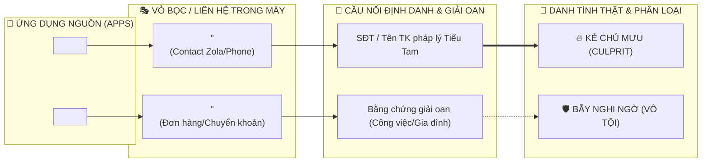
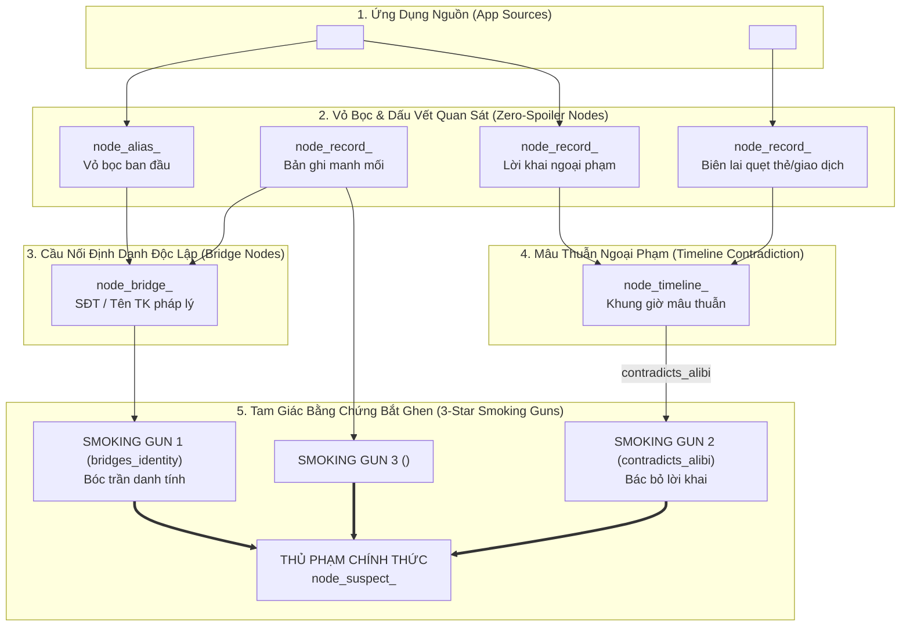

# Hồ sơ Đặc tả Cốt truyện - Màn <N>: <Tên Màn Chơi>

> **Thẩm quyền Tác giả**: Được thiết kế bởi `level-designer`. Là căn cứ cốt truyện pháp y duy nhất (SSOT) chứa kịch bản, thoại nhân vật, và mạng lưới manh mối gián tiếp. Bàn giao cho `@frontend-game-developer` để hiện thực hóa file cấu hình `src/data/cases/<husbandId>/level_0<N>.json`.

---

## 1. Bối cảnh Vụ án & Chân dung Người Chồng

### 1.1. Chân dung Người Chồng
- **Họ và Tên / Biệt danh**: <ví dụ: Hoàng - Chồng IT / Trưởng nhóm dự án>
- **Tuổi & Nghề nghiệp**: <ví dụ: 29 tuổi, Lập trình viên tại công ty công nghệ>
- **Nhóm tuổi & Thế hệ (generationTag)**: <Gen Z (20-25) | Millennial (26-35) | Gen X (36+)>
- **Phong cách Ngôn ngữ & Khẩu khí Chat (chatTone)**: <Văn phong chat, mức độ viết tắt, slang, sticker/meme theo level-design-rules.md Mục 3.2>
- **Thói quen Ứng dụng & Lối sống (lifestyleHabits)**: <Ứng dụng ưa chuộng, kiểu chi tiêu, loại vỏ bọc ngụy trang>
- **Tính cách Đặc trưng**: <ví dụ: Mẫu người hiền lành, giả vờ sợ vợ, luôn miệng khen vợ nấu ăn ngon nhưng có tật giấu "quỹ đen" và ôm điện thoại vào toilet>
- **Hành vi Khả nghi Gây ghen**: <ví dụ: Nửa đêm 23:45 điện thoại rung chuông nhẹ, úp màn hình xuống gối, vừa tắm vừa mang máy vào nhà tắm>

### 1.2. Chất liệu Trào phúng & Drama Gia đình Việt
- **Nguồn cảm hứng**: <ví dụ: Tâm sự Eva, hội nhóm Vén khéo, chiêu trò chuyển khoản 1.000đ khi bị chặn tin nhắn, đặt tên bồ là Anh Tuấn Thợ Điện>
- **Bản chất Câu chuyện**: <1-2 đoạn văn giải thích rõ bản chất thực sự của vụ việc: người chồng thực sự đang làm gì, quan hệ với ai, hoặc đang che giấu bí mật gì>


### 1.3. Chuỗi sự kiện thật - chỉ dành cho tác giả
<Hoàn thành mục 1.3–1.5 trước phân bổ ứng dụng, theo [phương pháp truyện trước ứng dụng](../../../../.agents/skills/level-designer/references/story-first-design.md). Các liên kết trong mẫu được tính từ thư mục hồ sơ đích `stories/husband-<name>/`.>

| Event ID | Thời điểm / khoảng thời gian | Ai làm gì, ở đâu | Động cơ / nguyên nhân từ sự kiện trước | Vật và người giữ trước → sau | Sự thật che giấu / lời khai |
|---|---|---|---|---|---|
| `<event_id>` | <thời điểm truyện> | <hành động> | <nguyên nhân> | <nếu có> | <nếu có> |

### 1.4. Hoạt động đời thường song song
| Activity ID | Thời điểm | Người liên quan | Hoạt động / mục đích bình thường | Kết quả / ngữ cảnh giải oan nếu có |
|---|---|---|---|---|
| `<activity_id>` | <thời điểm> | <người> | <gia đình, việc nhà, công việc, sở thích...> | <kết quả> |

### 1.5. Dòng thời gian câu chuyện
<Kể diễn biến nối các Event ID và Activity ID; tách điều tác giả biết với điều có thể quan sát. Chưa chọn app ở giai đoạn viết phần này.>

---

## 2. Danh sách Nghi phạm & Vỏ bọc Ngụy trang

| Suspect ID | Tên Hiển thị | Thân phận Thật / Nghề nghiệp | App Phát hiện Đầu tiên | Vỏ bọc Danh bạ / Biệt danh | Vai trò |
|---|---|---|---|---|---|
| `suspect_<tên_tiểu_tam>` | <ví dụ: Hương Marketing> | <ví dụ: Nữ đồng nghiệp cùng cơ quan> | `internet-messaging` | <ví dụ: "Anh Tuấn Thợ Điện"> | **Kẻ chủ mưu (Culprit)** |
| `suspect_<nghi_phạm_giả>` | <ví dụ: Mai Lễ Tân> | <ví dụ: Lễ tân tòa nhà văn phòng> | `ecommerce` | <ví dụ: "Mai Lễ Tân"> | Bẫy nghi ngờ (Red Herring) |
| `suspect_<người_thân>` | <ví dụ: Chị Mai> | <ví dụ: Chị gái ruột của chồng> | `phone` | <ví dụ: "Chị Mai Ruột"> | Người vô tội |

### 2.1. Sơ Đồ Bóc Trần Vỏ Bọc & Cầu Nối Danh Tính (Mermaid Identity & Alias Decoupling Map)
*Bắt buộc dựng sơ đồ Mermaid trực quan ánh xạ từ Ứng dụng $\to$ Vỏ bọc ngụy trang $\to$ Cầu nối độc lập $\to$ Nghi phạm thực tế (Thủ phạm vs Red Herrings):*



---

### 2.2. Danh mục Đối tượng Người chơi Nhìn thấy

| ID liên hệ / hội thoại | Loại (người / bí danh / nhóm / dịch vụ) | App | Tên nhìn thấy | Điều kiện vào bộ chọn nghi phạm / lý do loại trừ | Khóa gộp | Danh tính tác giả (không hiển thị) |
|---|---|---|---|---|---|---|
| `<contact_or_conversation_id>` | <loại> | `<app_id>` | <tên trên thẻ ghim> | <điều kiện theo hợp đồng app> | <khóa> | <ID hoặc chưa xác định> |

## 3. Sự thật, Lời Roasting & Thang Ngụy biện

### 3.1. Phân loại Kết luận Sự thật (Ground Truth)
- **Kết luận (`verdict`)**: `<cheating | innocent | sugar_relationship>`
- **Mã Tiểu tam (`culpritSuspectId`)**: `suspect_<tên_tiểu_tam>` (hoặc để trống `""` nếu kết luận là `innocent`)

### 3.2. Lời Roasting Kết thúc Vụ án
- **Chiến thắng Bắt ghen (`narrativeRoast`)**:
  > *"<1-2 câu châm biếm sâu cay, bóc trần toàn bộ chiêu trò của chồng và tuyên bố người vợ thắng cuộc>"*
- **Ghen Tuông Mù Quáng (`overJealousRoast`)**:
  > *"<Câu chọc quê hài hước khi người vợ kết tội nhầm người vô tội do suy bụng ta ra bụng người>"*
- **Bị Giật Lại Máy (Thất bại do hết lượt nghi ngờ)**:
  > *"Bị giật lại máy! Chồng giật phắt điện thoại: 'Nửa đêm không ngủ còn mò mẫm máy anh làm gì?'"*

### 3.3. Thang Ngụy biện Khi Đối chất Sớm ("Chối bay chối biến")
*Người chơi có thể bấm 'Đối chất' bất cứ lúc nào. Khẩu khí người chồng leo thang theo số lượng thẻ bằng chứng hợp lệ được đính kèm:*

| Số lượng Bằng chứng | Thái độ Người Chồng | Lời Thoại Ngụy biện Điển hình | Kết quả |
|---|---|---|---|
| **0 Thẻ (Cáo buộc non)** | Hùng hổ, tự tin | *"Em lại xem mấy video TikTok linh tinh rồi ghen bậy bạ đúng không? Đưa máy đây anh đi ngủ!"* | Thất bại (Không thuyết phục) |
| **1 Thẻ (Mới có 1 manh mối)** | Giật mình, phân bua | *"Ơ kìa, cái đấy là anh tiện tay giúp đồng nghiệp cùng phòng thôi mà, em làm gì mà nhảy dựng lên thế?"* | Chiến thắng 1 Sao (Thắng non) |
| **2 Thẻ (Đã đối chiếu 2 app)** | Toát mồ hôi, bao biện | *"Thì... thì đúng là có quen, nhưng bọn anh chỉ là bạn bè công việc trong sáng, có cả phòng làm chứng mà!"* | Chiến thắng 2 Sao (Thuyết phục) |
| **3+ Thẻ (Đủ tam giác bằng chứng)** | Cúi đầu nhận tội | *"Anh xin lỗi vợ ơi... Anh biết anh sai rồi, anh thề từ nay không bao giờ dám nữa, em tha cho anh lần này!"* | Chiến thắng Tuyệt đối 3 Sao |

---

## 4. Cấu hình Ứng dụng & Mồi nhử Thông báo (Notification Hook)

### 4.1. Phân cấp Độ khó
- **Phân bậc Màn chơi**: Màn <1 | 2 | 3>
- **Số lượt nghi ngờ tối đa (`allowedStrikes`)**: <Màn 1: 5 | Màn 2: 4 | Màn 3: 3>
- **Số app có manh mối**: <Màn 1: 3-4 | Màn 2: 5-6 | Màn 3: 8-11>
- **Số câu đố mã khóa (`lockChallenges`)**: <Màn 1: 0 | Màn 2: 1 | Màn 3: 2>

### 4.2. Bảng Phân bổ Trạng thái Ứng dụng
<Điền sau phần nền truyện; chọn app theo dấu vết tự nhiên và hợp đồng hiện hành.>

| App ID | Có clue / chỉ sinh hoạt | Event / Activity ID nguồn | Màn / trường hiện có | Khoảng trống hợp đồng nếu có |
|---|---|---|---|---|
| `<app_id>` | <vai trò> | <ID nguồn> | <khả năng đã xác minh> | <nếu có> |

### 4.3. Thông số Thiết bị & Thông báo Mồi nhử (Zero-Spoiler Hook)
- **Đồng hồ Cốt truyện (`narrativeTime`)**: `<ví dụ: 23:45>`
- **Thời lượng Pin (`batteryPercent`)**: `<ví dụ: 42%>`
- **Nhà mạng (`carrierTag`)**: `<ví dụ: 5G>`
- **Màu Chủ đề PWA (`pwaThemeColor`)**: `<ví dụ: #0f172a>`

**Thông báo Đẩy Khởi phát (Tuyệt đối không spoil):**
- **Toast ID**: `toast_01`
- **Ứng dụng Nguồn**: `<ví dụ: internet-messaging hoặc banking>`
- **Tiêu đề Người gửi**: `<ví dụ: Tin nhắn • Vừa xong>`
- **Nội dung Rút gọn**: `"<ví dụ: Anh Tuấn Thợ Điện: 'Tài liệu chiều nay em xem xong rồi, mai nhớ mang nốt cái kia nhé 😉'>"`
- **Thời gian Trì hoãn**: `<ví dụ: 4 giây>`

---

## 5. Đồ Thị Bằng Chứng & Ma Trận Dữ Liệu Pháp Y

### 5.1. Sơ Đồ Đồ Thị Bằng Chứng & Mâu Thuẫn Ngoại Phạm (Mermaid Diagram)
*Sơ đồ Mermaid trực quan thể hiện toàn bộ mắt xích từ Bản ghi App $\to$ Dấu vết $\to$ Cầu nối $\to$ Mâu thuẫn ngoại phạm $\to$ Tam giác Smoking Guns bóc trần Thủ phạm:*



### 5.2. Bảng Dữ Liệu Nodes & Edges (Compiler & Tooling SSOT)
*Đặc tả mạng lưới Node-Edge đồng bộ trực tiếp với hợp đồng `CaseKnowledgeGraph` trong `case-schema.ts`. Mọi màn chơi bắt buộc phải có bảng này.*

#### Danh sách Nodes
| Node ID | Loại (`type`) | Tên hiển thị (`label`) | App nguồn / Record ID | Clue ID (nếu có) | Vỏ bọc ban đầu (`isInitialDisguise`) |
|---|---|---|---|---|---|
| `node_suspect_<id>` | `suspect` | <Tên thật & nghề nghiệp> | - | - | `false` |
| `node_alias_<id>` | `alias` | <Tên ngụy trang trong app> | `<app_id>` / `<record_id>` | `<clue_id>` | `true` |
| `node_bridge_<id>` | `bridge_id` | <SĐT / Tên TK pháp lý> | `<app_id>` / `<record_id>` | - | `false` |
| `node_record_<id>` | `record_clue` | <Tên bản ghi / đơn / biên lai>| `<app_id>` / `<record_id>` | `<clue_id>` | `false` |
| `node_timeline_<id>`| `timeline_slot`| <Mốc thời gian cụ thể> | - | - | `false` |

#### Danh sách Edges & Smoking Guns
| Edge ID | Nút Nguồn (`source`) | Nút Đích (`target`) | Loại quan hệ (`relationship`) | Bằng chứng chốt (`isSmokingGun`) | Record ID nguồn / đích | Trường / nội dung nhìn thấy khớp nhau; chuẩn hóa cho phép | Tập bằng chứng tối thiểu phải ghim (Record ID / Message ID) | Kết luận được phép | Ca đạt / ca không đạt | Lời ngụy biện / bóc trần của Chồng |
|---|---|---|---|---|---|---|---|---|---|---|
| `edge_<id>` | `<node_A>` | `<node_B>` | `uses_alias` / `bridges_identity` / `occurred_at` / `contradicts_alibi` | `true` / `false` | `<record_A>` / `<record_B>` | <giá trị và quy tắc đối chiếu> | <các ID cụ thể> | <mức kết luận> | <đầu vào và kết quả mong đợi> | <lời thoại> |

<Áp dụng [quy tắc xác thực](../../../../.agents/skills/level-designer/references/story-first-design.md#3-kết-nối-rất-tinh-tế-nhưng-có-thể-kiểm-chứng). Đây là điều kiện bàn giao thiết kế, không tự bổ sung trường vào schema runtime.>

- **Danh sách Cạnh Bắt buộc để Thắng 3 Sao (`requiredSmokingGunEdgeIds`)**: `['edge_<id_1>', 'edge_<id_2>', 'edge_<id_3>']`

### 5.3. Thử thách Mã khóa & Câu đố (Dành cho Màn 2 & Màn 3)
*(Màn 1 để trống mục này: `lockChallenges: []`)*

| Challenge ID | Loại Đối tượng | ID Đối tượng / App | Loại Khóa | Đáp án / Mã PIN | App Chứa Manh mối | Clue ID | Câu hỏi Gợi ý (Chơi đẹp) |
|---|---|---|---|---|---|---|---|
| `lock_banking` | `app` | `banking` | `numeric_pin` | `1509` | `internet-messaging` | `CLUE-NOTE-01` | *"Nhập mã PIN 4 số của ứng dụng Ngân hàng (Gợi ý: Ngày kỷ niệm vào TechCorp)"* |

---

## 6. Lộ trình Phá án & Bảng Điều tra Nối dây

- **Đường suy luận trực quan**: Bắt đầu từ mồi nhử khởi phát `toast_01` $\to$ giải án theo sơ đồ tại [Mục 5.1](#51-sơ-đồ-đồ-thị-bằng-chứng--mâu-thuẫn-ngoại-phạm-mermaid-diagram).
- **Thứ tự gợi ý Giác quan thứ 6**: Hướng dẫn thứ tự app cần kiểm tra để định hướng người chơi chơi đẹp.
- **Đặc tả bố cục Bảng Điều tra Nối dây**: Tọa độ và cơ chế hoạt động của Canvas 2A tuân thủ [US-015](../../output/epic-03-wife-notebook-verdict-social-sharing/us-015-wife-split-section-investigation-notebook-suspect-evidence-linkage-hub.md#corkboard-canvas-layout--swimlane-architecture).

---

## 7. Bàn giao Kỹ thuật cho Lead Dev Agent

### 7.1. File Cấu hình Đích
`src/data/cases/<husbandId>/level_0<N>.json`

### 7.2. Yêu cầu Cấu trúc Mock Data & Chuẩn Gói 2 File
- Mỗi màn chơi hoàn chỉnh gồm **đúng 2 files**: hồ sơ đặc tả này (`level-0<N>.md`) và kịch bản chi tiết (`level-0<N>-phone-data.md`). Tuyệt đối không tạo file thứ ba `history.md`.
- Kịch bản `level-0<N>-phone-data.md` chỉ giới hạn trong khoảng thời gian D-Day $\pm$ 2–3 ngày, đảm bảo $\ge 75\%$ bản ghi sinh hoạt/giải oan để che giấu manh mối. Dữ liệu nền quá khứ sâu sẽ do dev nạp từ shared mock fixtures.
- Dữ liệu `appsData` dùng ID app hiện hành theo phân bổ ở mục 5; `phone` và `messages` là hai app riêng, `comms` chỉ là dữ liệu cũ cần chuẩn hóa theo hợp đồng runtime.
- Bảo đảm tính gián tiếp, tuyệt đối không chèn thêm các trường hay nhãn lộ liễu (như tự ghi `suspectName` lộ liễu trong giao dịch).
- Ngân hàng chỉ ghi tên pháp lý của chủ tài khoản; ánh xạ nghi phạm nằm ở metadata tác giả.
- Hội thoại `internet-messaging` tuân thủ chính xác văn phong tự nhiên, không lộ liễu.

### 7.3. Tiêu chí Nghiệm thu Pháp y
1. Chạy lệnh kiểm tra hồ sơ cốt truyện:
   ```bash
   python .agents/skills/level-designer/scripts/sync_clues.py verify-spec ".agent-artifacts/requirements/stories/husband-<name>/level-0<N>.md"
   ```
2. Đảm bảo toàn bộ Clue IDs tồn tại trong danh mục và tuân thủ định dạng `CLUE-<APP>-XX`.
3. Kết quả [đọc duyệt ngữ nghĩa](../../../../.agents/skills/level-designer/references/story-first-design.md#4-đọc-duyệt-ngữ-nghĩa-trước-bàn-giao): <đường giải đã đối chiếu, phụ thuộc thay đổi, khoảng trống>.
4. Bàn giao các ca kiểm tra cho [đọc duyệt triển khai](../../../../.agents/skills/level-designer/references/story-first-design.md#5-đọc-duyệt-khi-triển-khai-hoặc-sửa-dữ-liệu-truyện): <ca kiểm tra / phần runtime chưa kiểm chứng>.
