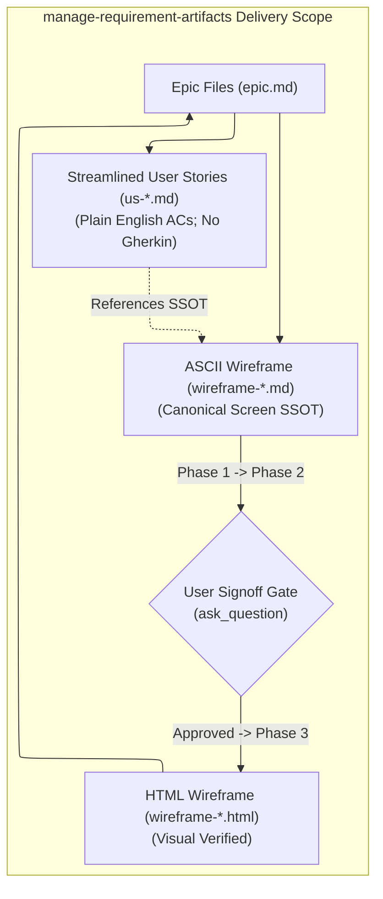

# Requirement Artifact Management Skill

## Purpose & Scope

Maintain `.agent-artifacts/requirements/` as the BA delivery workbench. Manage canonical epic files (`epic.md`), streamlined user stories (`us-*.md`) with plain English Acceptance Criteria, and coordinate the canonical visual specification workflow:
**Generate ASCII Wireframe -> Signoff Gate -> Generate HTML Wireframe**.

> [!IMPORTANT]
> **Wireframe-First Requirement SSOT & Plain English Stories**:
> - **Plain English Acceptance Criteria**: User stories (`us-*.md`) must contain an Acceptance Criteria section written strictly in **plain English** (numbered or bulleted clear behavioral conditions). Fenced Gherkin blocks (`Given / When / Then`), 3-tier Gherkin layering, and semantic predicate test tables are strictly prohibited.
> - **Streamlined User Story Structure**: Business value ("so that" clauses), RAID logs, and pre-conditions are removed from user stories. Stories focus cleanly on actor persona, user goal (`As a <role>, I want <goal>`), plain English ACs, and a direct link to the canonical wireframe SSOT.
> - **GUI Spec Bypass**: Standalone GUI specifications (`gui-*.md`) are bypassed.
> - **Canonical Visual Specification Pipeline**: All screen layout, component inventories, touch targets, state indicators, and interactions are specified through:
>   1. **ASCII Wireframe Generation (`wireframes/wireframe-*.md`)**: Authored first and grounded in canonical `app-design.md`.
>   2. **Signoff Gate**: Explicit user review and signoff checkpoint.
>   3. **HTML Wireframe Generation (`wireframes/wireframe-*.html`)**: Interactive HTML mockup created only after signoff, verified with screenshot visual review.

This skill is the **Single Source of Truth (SSOT)** for deliverable placement and artifact lifecycle under `.agent-artifacts/requirements/output/`.

---

## Artifact Traceability & Structure Scope

This diagram illustrates the artifact relationships managed within `.agent-artifacts/requirements/output/`:



### Incoming Handoffs:
- **From `functional-decomposition` / `functional-decomposition.md`**: Reads target `<epic-slug>` capability slices $\rightarrow$ authors `<epic-slug>/epic.md`, streamlined `us-*.md` user stories (plain English ACs, no Gherkin, no RAID/pre-conditions), and initiates ASCII wireframe authoring (`<epic-slug>/wireframes/wireframe-<slug>.md`). Standalone `gui-*.md` specs are bypassed.
- **From `generate-wireframe`**: Provides wireframe guidelines and scaffolding $\rightarrow$ authors ASCII wireframe first; upon user signoff, generates interactive `.html` wireframe and executes automated screenshot visual inspection.
- **From `generate-diagram`**: Receives process/state flow diagrams $\rightarrow$ embeds links into epic and user story reference tables.

### Outgoing Handoffs:
- **To `generate-wireframe`**: Invoked post-signoff to build interactive HTML wireframes and render screenshot for visual multimodal review.
- **To `clarify-api-requirements`**: When backend endpoint contracts or schemas are required.
- **To `sync-backlog`**: When backlog-ready items are ready for Jira or Azure DevOps sprint synchronization.
- **To `update-project-knowledge`**: When stable domain concepts or UI patterns distill into `.agent-artifacts/project-knowledge-base/`.

---

## Ownership (SSOT for `.agent-artifacts/requirements/`)

This skill manages files within the canonical folder hierarchy:

```text
.agent-artifacts/requirements/
|-- input/                          <-- Raw client intake, briefs, tickets, screenshots
`-- output/                         <-- Canonical delivery hierarchy (using frontmatter status: draft / refinement / signed-off)
    |-- vision-scope.md             <-- Overall product vision & scope
    |-- functional-decomposition.md <-- Overall capability breakdown
    |-- elicitation/                <-- Project-wide discovery notes & interview sessions
    |   `-- elicitation-<session-slug>.md
    `-- <epic-slug>/                <-- Epic delivery folder
        |-- epic.md                 <-- Canonical epic definition and child artifact links
        |-- elicitation-<session-slug>.md  <-- Epic discovery & Q&A notes
        |-- <user-story-id-or-slug>.md     <-- Streamlined story (Plain English ACs; No Gherkin)
        |-- api-<api-slug>.md              <-- Optional API spec (if needed)
        |-- wireframes/
        |   |-- wireframe-<slug>.md        <-- Phase 1: ASCII Wireframe (Canonical Screen SSOT)
        |   |-- wireframe-<slug>.html      <-- Phase 3: Interactive HTML Wireframe (Post-Signoff)
        |   `-- wireframe-<slug>.png       <-- Rendered screenshot for visual review
        `-- diagrams/
            |-- diagram-<diagram-slug>.md
            `-- diagram-<diagram-slug>.bpmn
```

### Reference Guidelines & Templates
- **User Stories (Plain English ACs)**: `assets/user-story-template.md` & `references/user-story-guidelines.md` (plain English ACs; business value, RAID logs, and pre-conditions removed)
- **Definition of Ready (DoR)**: `references/definition-of-ready.md` (plain English AC & wireframe-first DoR standards)
- **ASCII Wireframes (Canonical Screen SSOT)**: `.agents/skills/generate-wireframe/references/text-wireframe-guide.md` & Canonical Micro-App `app-design.md` specifications
- **Interactive HTML Wireframes**: `.agents/skills/generate-wireframe/references/html-wireframe-guide.md`
- **Epic Placement & Navigation**: `assets/epic-template.md` & `references/artifact-guidelines.md`
- **Vision & Scope**: `assets/vision-scope-template.md`

---

## Workflow

1. **Read Current State & Vision-Scope Gate**:
   - **Vision-Scope Prerequisite**: Before drafting any epic, story, or wireframe, check whether `.agent-artifacts/requirements/output/vision-scope.md` exists.
     - If this is a **new project** (no `vision-scope.md` present): author it now using `assets/vision-scope-template.md`, populated from the signed-off elicitation session passed by `ba`. Do not author epics or stories until `vision-scope.md` is written and confirmed.
     - If this is an **ongoing project** with an existing `vision-scope.md`: read it to establish the current scope baseline before proceeding.
   - Read the target epic folder's current `epic.md` and existing wireframes/stories. Note existing story IDs to continue numbering without collision.

2. **Consume Decomposed Slices & Mandatory Elicitation Gate**:
   - Read the target `<epic-slug>` section from `functional-decomposition.md` to retrieve capability slices and actor goals.
   - **Stand-Alone GUI Spec Bypass**: Skip authoring `gui-*.md` files. Screen layouts, component hierarchies, and interactive states are specified directly via wireframes.
   - **Plain English AC Rule**: Draft Acceptance Criteria strictly in plain English (numbered or bulleted clear behavioral conditions). Do NOT use Gherkin (`Given/When/Then`) syntax. Omit business value clauses ("so that"), RAID logs, and pre-conditions.
   - **Pre-Authoring Elicitation Gate (Universal Invariant)**: Before creating or modifying any deliverable, verify that an interactive clarification batch (`ask_question`) for that specific target was presented and answered in the active conversation turn, or that the user explicitly directed `"skip elicitation"` / `"use defaults"`. If neither condition is met, HALT file creation/editing and return that target to `elicit-requirements`.

3. **Present Authoring Plan for Approval & Cadence**:
   - Before creating, editing, or overwriting any file, contribute this skill's Epic, Streamlined User Story, and Wireframe rows to the orchestrator's combined artifact plan:

   | Artifact Type | Action | Owner | File Path | What Changes / Dependency |
   |---|---|---|---|---|
   | Epic | `CREATE` \| `UPDATE` \| `NONE` | `manage-requirement-artifacts` | `<epic-slug>/epic.md` | New epic container & child artifact inventory |
   | Streamlined User Story | `CREATE` \| `UPDATE` \| `NONE` | `manage-requirement-artifacts` | `<epic-slug>/us-<id>-<slug>.md` | Delivery slice (`As a <role>, I want <goal>`) with plain English ACs & wireframe link |
   | ASCII Wireframe | `CREATE` \| `UPDATE` \| `NONE` | `generate-wireframe` / `manage-requirement-artifacts` | `<epic-slug>/wireframes/wireframe-<slug>.md` | **Phase 1**: Canonical screen hierarchy, layout, touch targets & clue placement |
   | User Signoff Gate | `GATE` | User | N/A | **Phase 2**: Mandatory signoff on ASCII wireframe before HTML wireframe generation |
   | HTML Wireframe | `CREATE` \| `UPDATE` \| `NONE` | `generate-wireframe` | `<epic-slug>/wireframes/wireframe-<slug>.html` | **Phase 3**: Interactive HTML mockup with CSS tokens & multimodal visual review |
   | GUI Specification | `NO ACTION` (Bypassed) | `manage-requirement-artifacts` | `<epic-slug>/gui-*.md` | Standalone GUI spec bypassed in favor of ASCII wireframe SSOT |

   - Do not write any file until the user confirms the combined plan and authoring cadence (**Iterative Visual Review** recommended).

3a. **Visual & Structural Specification Gate (Grounded in `app-design.md`)**:
   - Before authoring or presenting the ASCII wireframe, inspect the canonical `app-design.md` for the target micro-app under `.agent-artifacts/project-knowledge-base/solution-context/apps/<app-id>/app-design.md` (or `phone-os/app-design.md`).
   - Ground the ASCII wireframe in:
     - Exact ASCII screen layout blocks and component hierarchy.
     - Brand color palette and surface background tokens.
     - Strict touch target minimums ($\ge 44 \times 44\text{px}$ for buttons/tabs; $\ge 48\text{px}$ for search bars/inputs).
     - Apple Dynamic Island pill, split status bar, and Ionicons vector SVG icons (Strict Zero-Emoji Policy).
     - Clue discovery points and forensic suspect tags.

4. **Folder & Naming Conventions**:
   - Use stable lowercase hyphenated slugs (e.g., `epic-01-virtual-phone-app-ecosystem`, `us-001-case-schema-engine.md`, `wireframe-phone-shell-launcher.md`).
   - Store wireframes under `<epic-slug>/wireframes/`.

5. **Draft Artifacts (The 3-Phase Wireframe-First Progression)**:
   - **Streamlined User Stories (`us-*.md`)**:
     - Frontmatter with `status: draft`, `epic: <Epic Name>`, and tags.
     - Simplified story statement: `As a <role>, I want <goal>` (no "so that" business value clause).
     - Direct pointer to the wireframe SSOT: `[ASCII Wireframe](./wireframes/wireframe-<slug>.md)` and `[Interactive HTML Wireframe](./wireframes/wireframe-<slug>.html)`.
     - **Acceptance Criteria in Plain English**: Numbered or bulleted clear behavioral statements specifying expected actions, UI updates, and error toasts. **Strictly NO Gherkin syntax.**
     - **Omitted sections**: No business value, no RAID logs, no pre-conditions.
   - **Phase 1: Generate ASCII Wireframe (`wireframe-*.md`)**:
     - Author `<epic-slug>/wireframes/wireframe-<slug>.md` with PRD-ready structural hierarchy, ASCII layout boxes, bracketed semantic tokens (`[Dynamic Island]`, `[Signal 5G]`), component inventories, touch target annotations, and UX interaction notes.
   - **Phase 2: User Signoff Gate**:
     - Present the completed ASCII wireframe to the user for explicit review and signoff (`ask_question`).
     - **HALT CONDITION**: Never proceed to HTML wireframe generation without explicit user approval of the ASCII wireframe.
   - **Phase 3: Generate Interactive HTML Wireframe (`wireframe-*.html`)**:
     - After signoff is granted, trigger `generate-wireframe` to scaffold `<epic-slug>/wireframes/wireframe-<slug>.html` with embedded CSS tokens and mobile container.
     - Execute the automated multimodal visual review gate: render screenshot via `render_screenshot.ps1` and visually inspect `<slug>.png` via `view_file`.

6. **Validate Deliverables & Relative Links**:
   - Run `powershell -NoProfile -File .agents/skills/manage-requirement-artifacts/scripts/validate_requirements.ps1 --epic "<epic-folder-path>" --terse` to verify relative link integrity, frontmatter status, story statements (`As a <role>, I want <goal>`), and plain English Acceptance Criteria.

---

## Core Tooling (in `scripts/`)

Directly invoke these utilities using the exact CLI syntax below; do not inspect script source code unless diagnosing an execution error:

| Utility | Script Command | Description |
|---|---|---|
| **DoR & Link Linter** | `powershell -NoProfile -File .agents/skills/manage-requirement-artifacts/scripts/validate_requirements.ps1 --epic "<epic-folder-path>" --terse` | Verifies frontmatter status, story statements (`As a <role>, I want <goal>`), plain English Acceptance Criteria presence, wireframe link resolution, and relative markdown links. Fenced Gherkin ACs, RAID logs, and pre-conditions are not required. `--terse` emits 1-line actionable findings (`path: severity: issue`). Use `--all` for repository-wide audits. |

---

## Terse Audit Findings Protocol (Crediting `caveman-review`)

When auditing requirements, user stories, or PR deliverables, output findings in terse, 1-line format rather than verbose narrative:
- **Format**: `<file>:L<line>: <emoji> <severity>: <problem>. <fix>.`
- **Severities**: `🔴 error:` (broken links / missing plain English ACs), `🟡 warning:` (unpopulated placeholders), `🔵 nit:` (styling / minor copy), `❓ q:` (unresolved question).
- **Totals**: `totals: N🔴 N🟡 N🔵 N❓` or `No issues.`

---

## Artifact Boundaries

- **Owns**: Canonical epic containers (`epic.md`), streamlined user stories (`us-*.md`) with plain English ACs, ASCII wireframe coordination and linking, user signoff gate enforcement.
- **Does Not Own**: Gherkin AC authoring (strictly prohibited), standalone GUI specs (bypassed), system decomposition (`functional-decomposition`), endpoint schemas (`clarify-api-requirements`), Mermaid/BPMN diagrams (`generate-diagram`), or raw HTML mockup scaffolding (`generate-wireframe`).
- Do not move deliverables to `.agent-artifacts/project-knowledge-base/` or edit raw files in `.agent-artifacts/requirements/input/`.

