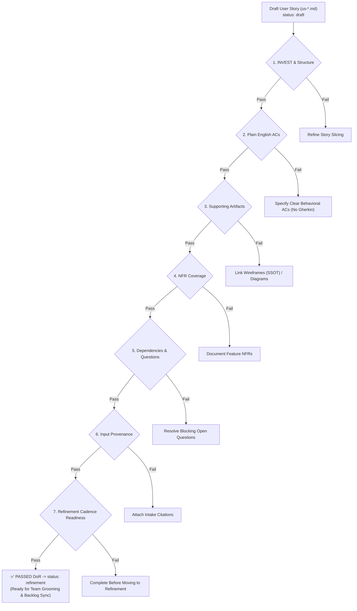

# Definition of Ready (DoR) - In-Repo Standard

This document is the **Single Source of Truth (SSOT)** for evaluating whether a User Story and its supporting requirement artifacts are complete, unambiguous, and ready for Agile Scrum Sprint Planning and AI Spec-Driven Development (AI-SDD).

> [!NOTE]
> **Boundary Note**: Technical Architecture (TA/TL) reviews and contractual Client Sign-Offs are conducted outside this repository. This document governs all **in-repo requirement quality, structural completeness, traceability, and AI-executable testability**.

---

## DoR Evaluation Gate

Before any user story transitions from `status: draft` to `status: refinement` (and becomes eligible for team backlog grooming and sync to Jira/Azure DevOps), it must satisfy all 7 in-repo DoR criteria below.



---

## The 7 In-Repo DoR Criteria

### 1. User Story Structure
- [ ] **Compulsory Parent Epic**: The story frontmatter specifies `epic: <Epic Name>` and is listed in the parent `<epic-slug>/epic.md`.
- [ ] **Streamlined Story Statement**: Follows `As a <persona/user role>, I want <user goal>` (business value "so that" clause is omitted).
- [ ] **Independent & Small**: Sized to $\le 1$ week of delivery effort (fits safely inside a single Scrum sprint) without circular dependencies on other in-flight stories.
- [ ] **RAID Log & Pre-conditions Removed**: In-story RAID logs and pre-condition tables are removed from delivery criteria.

> [!IMPORTANT]
> **Plain English Acceptance Criteria & Wireframe SSOT**:
> In this workspace, user stories MUST have Acceptance Criteria written in **plain English** (numbered or bulleted clear behavioral conditions).
> - **Zero Gherkins**: Fenced ````gherkin```` blocks, Given/When/Then keywords, and 3-tier layering are strictly prohibited.
> - **Visual Specification Pipeline**: Screen layouts, UI hierarchies, and interactive states are governed by:
>   1. **Phase 1: Structured ASCII Wireframe (`wireframes/wireframe-*.md`)** authored and grounded in canonical `app-design.md`.
>   2. **Phase 2: Explicit User Signoff Gate** obtained via `ask_question`.
>   3. **Phase 3: Interactive HTML Wireframe (`wireframes/wireframe-*.html`)** generated post-signoff and visually verified.
> Stories link directly to the wireframe SSOT.

### 2. Acceptance Criteria: Plain English Behavioral Conditions
- [ ] **Observable & Testable**: Criteria are numbered or bulleted clear behavioral statements describing explicit user interactions and system outcomes.
- [ ] **Zero Gherkin Syntax**: Free of `Given / When / Then / And` keywords and fenced ````gherkin```` code blocks.
- [ ] **Exact Quote-Delimited Error Copy**: Every validation error, business block, or exception explicitly quotes the exact user-facing message text (e.g., `If the PIN is incorrect, display error toast: "Mã PIN không đúng."`).
- [ ] **Comprehensive Paths Covered**: Captures primary success flow, boundary conditions, input restrictions, and failure handling without narrative filler.

### 3. Supporting Artifact Linkages
- [ ] **Screen / UI Impact**: If the story touches a user interface, it references the canonical ASCII wireframe (`./wireframes/wireframe-<slug>.md`) and post-signoff HTML wireframe (`./wireframes/wireframe-<slug>.html`). Standalone GUI specs (`gui-*.md`) are bypassed.
- [ ] **API / Backend Impact**: If the story defines an API contract, it references an approved API specification (`api-<api-slug>.md`).
- [ ] **Process / Workflow Flow**: If the story involves state transitions or multi-step logic, it references a workflow diagram (`./diagrams/`).
- [ ] **Zero Dead Links**: All relative Markdown links resolve to real files within the workspace.

### 4. Non-Functional Requirements (NFR) Coverage
- [ ] **Feature-Specific NFRs Documented**: Story contains an explicit `Non-functional Requirements` table capturing any story-specific performance (SLA/latency), security (PII/field encryption), audit logging, or accessibility constraints.
- [ ] **Platform NFR Alignment**: If no story-specific NFR is needed, the table confirms adherence to global platform NFR standards (e.g., standard authentication, global response threshold).

### 5. Dependency & Question Resolution
- [ ] **Zero Blocking Open Questions**: All material questions impacting scope, logic, or acceptance criteria are resolved (`Status: Resolved`). Zero blocking questions remain in the `Open Questions` table.
- [ ] **Dependencies Cleared**: All prerequisite services, external APIs, and prerequisite stories are identified with owners and target delivery readiness.
- [ ] **No RAID/Pre-condition Tables**: Explicitly omitted from user stories.

### 6. Input Provenance & Traceability
- [ ] **Intake Provenance**: The `Citations` table identifies the source brief, client ticket, meeting notes, or intake document in `.agent-artifacts/requirements/input/` from which the story originated.

### 7. Refinement Cadence & Readiness Cutoff
- [ ] **Cutoff Prior to Backlog Refinement**: All above criteria must be satisfied so the story enters Backlog Refinement with a complete, structured specification, giving the development team stable material for estimation and sizing.

---

## Status Lifecycle Mapping

| Frontmatter Status | Meaning in DoR Lifecycle |
|---|---|
| `status: draft` | Story is actively being authored or elicited by the BA; DoR checks incomplete. |
| `status: refinement` | **Passed all in-repo DoR checks.** Story specification is complete, robust, and ready for team backlog grooming and estimation. |
| `status: signed-off` | Formally reviewed and accepted by team and stakeholders for active sprint execution. |
